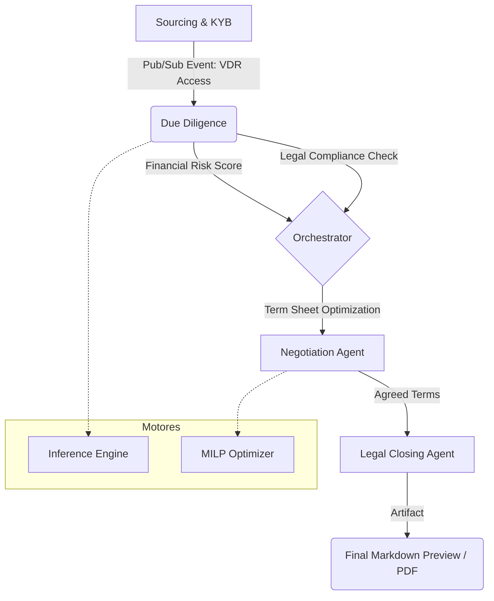

# M&Ai - MVP Monolítico

Middleware de arquitetura "low-touch" projetado em **Deno** para automatizar,
otimizar e desintermediar o ciclo de vida de transações de Fusões e Aquisições
(M&A), com foco nos mercados _middle-market_ e _lower-middle-market_.

O projeto combina a produtividade e a segurança do TypeScript no ecossistema
Deno com motores de alta performance (WASM / ONNX) e uma avançada camada
agêntica suportada pelo ADK e framework Mastra.

## Estado atual do MVP_6

O MVP_6 inclui uma interface web funcional e coerente, construída a partir do
contrato visual Mastercard Editorial do projeto Stitch
`1310231555884111730`. As famílias implementadas são:

- pipeline de deals em Board, Table e Detail;
- CRUD reutilizável de entidades Buyer, Seller, Target e Institution;
- workspace agêntico com histórico, streaming SSE, reconexão, citações e runs;
- dashboard customizável com widgets versionados.

O adaptador de contratos do MVP_6 em `src/api/mvp_routes.ts` usa armazenamento
em memória durante o processo. Portanto, os dados dessas telas são reiniciados
quando a API é reiniciada. A arquitetura PostgreSQL descrita abaixo continua
sendo a persistência do domínio e o destino de evolução, mas não deve ser
confundida com persistência definitiva de todas as rotas do protótipo.

O prompt Stitch único e seu mapa de estados estão validados, porém a geração no
Stitch ainda é parcial: foram materializadas oito telas representativas, não
todas as variações nomeadas em 2560×1440. A implementação local e a geração do
Stitch são acompanhadas separadamente para não declarar como concluído um
artefato visual incompleto.

---

## 📐 Estrutura do Projeto

O repositório é estruturado de forma a separar a interface web (Next.js) do
motor de regras, banco de dados e inteligência agêntica (Deno).

```
.
├── gui/                    # Dashboard Web (Next.js / React 19 / Tailwind CSS)
└── src/                    # Backend API, Motores e Agentes (Deno)
    ├── api/                # API MVP_6 com fachadas estáveis e módulos por domínio
    │   ├── contracts.ts    # Barrel público para api/contracts/
    │   ├── mvp_store.ts    # Fachada pública para api/store/
    │   ├── mvp_routes.ts   # Orquestrador público para api/routes/
    │   ├── contracts/      # DTOs e envelopes por domínio
    │   ├── store/          # Repositórios in-memory por domínio
    │   └── routes/         # Handlers HTTP/SSE ordenados por domínio
    ├── agent/              # Camada agêntica (ADK TypeScript / Mastra)
    │   ├── agents/         # Definição dos 7 Agentes de M&A
    │   ├── workflows/      # Pipelines determinísticos e validação Zod
    │   ├── context/        # Adaptadores para VDR, Engines e DB
    │   ├── actions.ts      # As 5 Ferramentas Globais do ADK
    │   └── index.ts        # Ponto de entrada central do ecossistema
    ├── cli/                # Interface CLI (Legada / Alternativa de depuração)
    ├── core/               # Lógica de negócio, conexões e barramento
    │   ├── db/             # Persistência Postgres, schema SQL e Memory Service
    │   ├── pubsub.ts       # Barramento local assíncrono (simulador Pub/Sub)
    │   └── vdr.ts          # Integração de Core API para Virtual Data Rooms
    └── engines/            # Motores de computação pesada
        ├── prediction/     # IA preditiva, classificadores ONNX e Transformers
        ├── optimization/   # Otimização matemática (MILP e Algoritmos Genéticos)
        └── document-generator/ # Geração de contratos em PDF (pdf-lib) e LaTeX
```

---

## 🤖 O Ecossistema Agêntico (ADK TypeScript)

A inteligência da aplicação reside no `src/agent/`, estruturada em **7 Agentes
Especializados** que compartilham acesso universal ao VDR, Engines e Banco de
Dados:

1. **`BrokerOrchestratorAgent`**: Orquestrador principal. Supervisiona o fluxo e
   separa ativamente conhecimentos de domínio (_Domain Knowledge_) de
   preferências do usuário (_User Preferences_) no Database Memory Service.
2. **`SourcingAndKYBAgent`**: Conduz a qualificação de contrapartes. Vai além
   dos dados cadastrais e dívidas fiscais (SERPRO/Receita), analisando o fator
   humano: cultura corporativa, movimentações passadas e perfil dos
   negociadores.
3. **`GeneralDueDiligenceAgent`**: Canal direto do usuário para assuntos de
   auditoria. Orquestra e sintetiza as análises de dois subagentes
   especializados:
   - **`FinancialRiskAgent`**: Investiga balanços e DREs usando o motor ONNX
     para prever insolvência e volatilidade.
   - **`LegalDueDiligenceAgent`**: Varre RAG de VDR buscando riscos jurídicos e
     cláusulas de _Change of Control_.
4. **`DealMatchingAgent`**: Responsável pela modelagem de propostas financeiras.
   Prioriza faixas flexíveis de negociação (_valuation ranges_) para poupar as
   partes de desgaste desnecessário (_deal fatigue_).
5. **`NegotiationAgent`**: Conselheiro estratégico iterativo. Nunca dita termos
   finais; apresenta sempre 3 ou mais cenários de oportunidade (permuta entre
   _Cash_, _Equity_, _Earn-outs_ e _Escrow_).
6. **`LegalClosingAgent`**: Emissor formal de documentos. Exibe uma visualização
   prévia estruturada do contrato em Markdown no terminal da CLI, aguardando
   aprovação prévia do usuário (HITL) antes de compilar os binários.

### As 5 Integrações do ADK (`src/agent/actions.ts`)

As ferramentas globais foram totalmente conectadas a implementações reais para
evitar dependência de mocks:

- **`Google Cloud Pub/Sub tool`**: Conectada ao `LocalPubSubBus` no runtime do
  Deno para simular o tráfego do Cloud Pub/Sub de forma local e determinística.
- **`MCP Toolbox for Databases tool`**: Conectada com o repositório PostgreSQL
  real (`DatabaseMemoryService`).
- **`Hugging Face MCP tool`**: Realiza inferência nativa local consumindo a
  arquitetura ONNX/Transformers do sistema.
- **`Gemini API Google Search tool`**: Habilitada com _grounding_ real do Google
  Search via Gemini 3.1 Pro.
- **`Database Memory Service`**: Integrado ativamente para ler e escrever
  memórias persistentes durante a execução dos workflows.

Todos os agentes foram padronizados para rodar exclusivamente no modelo **Gemini
3.1 Pro** via `@ai-sdk/google`.

---

## 🗄️ Persistência de Dados (PostgreSQL)

A aplicação faz uso do PostgreSQL (`src/core/db/`) para garantir o isolamento
fiduciário e rastreabilidade:

- **Tabelas Operacionais:** `transaction`, `business`, `financial_structure`,
  `advisor`, etc.
- **Histórico Operacional (`phase_history`):** Exclusivo para o andamento e
  status do M&A deal flow em formato JSONB.
- **`Database Memory Service`:** Separação limpa em tabelas próprias para
  guardar preferências do usuário e inteligência cultural, preparadas para
  futuras consultas via `pg_vector`.

---

## ☁️ Nota Arquitetural de Evolução (GCP)

Este MVP monolítico foi desenhado sob princípios de forte desacoplamento (ex:
comunicação Core <-> Agentes via mensageria assíncrona em `pubsub.ts`) com o
objetivo de garantir uma futura transição sem atritos para a Google Cloud
Platform (GCP).

Na fase corporativa (pós-MVP), a infraestrutura evoluirá para:

- **Entrada:** Cloud Load Balancing e Cloud API Gateway.
- **Comunicação:** Google Cloud Pub/Sub orquestrando requisições de VDR à Core
  API e acionamento de Engines.
- **Execução & AI:** Engines hospedadas no Cloud Run; Camada Agêntica executada
  via endpoints seguros da Vertex AI e BigQuery.
- **Persistência:** Cloud Storage para documentos/ONNX e Postgres em Replica
  Pool (Master/Slaves) com suporte vetorial.

---

## 🔄 Fluxo End-to-End (E2E)

A aplicação processa o ciclo de vida da transação em etapas assíncronas através
dos agentes:



**Artefatos Gerados:**

- **Sourcing Report**: Qualificação da empresa e reputação.
- **Risk Score**: Score quantitativo preditivo de falência gerado pelo modelo
  ONNX local.
- **Legal Summary**: Análise jurídica via RAG baseada em documentos locais.
- **Closing Preview**: Markdown estruturado exibido ao usuário com os termos
  finais antes da geração do PDF.

## 📖 Sumário do Conhecimento Adicional

Para permitir uma compreensão imediata das especificidades técnicas do
middleware antes de abrir o código-fonte, organizamos o conhecimento central por
domínios estruturais da aplicação:

### 🧠 Inteligência Artificial e Orquestração

O coração do sistema é o **Ecossistema Agêntico** (`AGENTS.md`), que coordena 7
agentes especializados (desde _Sourcing_ até _Legal Closing_) através do
framework Mastra. Eles operam de forma isolada, porém integrada, acessando
ferramentas globais como `Google Search`, `MCP PostgreSQL` e inferência local
via Hugging Face Transformers.

Para proteger as informações fiduciárias das transações, a inteligência conta
com um modelo de **RAG Silado** (`continuous_learning_and_rag.md`). Os dados dos
clientes nunca se misturam; eles são estritamente filtrados por ID de transação
e armazenados no PostgreSQL (`pgvector`) para viabilizar buscas semânticas
seguras e permitir que o motor de aprendizado contínuo guarde as preferências do
usuário.

### ⚙️ Motores de Otimização e Negociação

A tomada de decisão automatizada é sustentada por três motores matemáticos
essenciais:

- **Seleção de Portfólio (MILP)** (`optimization_portfolio_solver.md`): Utiliza
  programação linear mista para selecionar a melhor cesta de aquisições,
  respeitando limites rígidos de orçamento e exclusões mútuas.
- **Criação de Term Sheets (Genético)** (`term_sheet_genetic_optimizer.md`): Um
  algoritmo genético que busca o Equilíbrio de Nash simulando propostas. Ele
  evolui cenários (dinheiro, equity, earn-out) focando em maximizar o acordo
  entre as partes.
- **Filtro de Governança (CP)** (`constraint_negotiation_api.md`): Submete as
  propostas geradas à programação por restrições, eliminando cenários que violem
  métricas como alavancagem de dívida (`LeverageConstraint`) e regras de
  compliance (`KycConstraint`).

### 📊 Modelagem Financeira e Machine Learning

A precisão na análise dos negócios é garantida por regras determinísticas e por
predição baseada em redes neurais:

- **Valuation Determinístico** (`valuation.md`): O sistema aplica 6 métodos
  clássicos e infalíveis de cálculo (como _DCF_, _Múltiplos de EBITDA_ e
  _Enterprise Value_).
- **Motor Preditivo ONNX** (`prediction_engine.md` e `onnx_bootstrapper.md`):
  Para avaliar a saúde financeira em frações de segundo, um modelo de _Deep
  Learning_ (treinado em GPU no Colab e exportado para `.onnx` em 8-bits) é
  carregado na memória do Deno. Ele gera um score preditivo de insolvência que é
  traduzido para as métricas clássicas de Altman Z-Score.

### 🔌 Infraestrutura, Segurança e Interfaces

Para suportar toda essa inteligência de forma auditável, o M&Ai foi desenhado
sob uma arquitetura resiliente:

- **Conectividade Segura** (`vdr_integration_supergood.md` e
  `database_memory_singleton.md`): O tráfego para os Virtual Data Rooms é
  blindado pelo proxy **Supergood** para auditoria. A persistência no PostgreSQL
  segue um estrito padrão Singleton, garantindo que os agentes não esgotem o
  pool de conexões durante as execuções paralelas.
- **Visualização Web** (`context/nextjs_gui_and_api.md` e `gui/README.md`): o
  painel Next.js 16 usa um shell único e componentes Mastercard Editorial. As
  rotas `/`, `/deals`, `/deals/:id`, `/entities`, `/entities/:id`,
  `/deals/:id/chat` e `/dashboard/custom` compartilham contratos tipados no
  `ApiClient`. O Next.js encaminha `/api/*` à API Deno por rewrite configurado
  por `MAI_API_BASE_URL`, inclusive o streaming SSE do workspace agêntico.
- **O Caminho para a Nuvem** (`architecture.md`): O monolito atual foi
  intencionalmente construído com mensageria assíncrona (simulando Pub/Sub)
  preparando sua migração natural para serviços Serverless da GCP (Cloud Run,
  Vertex AI e Cloud SQL).

---

## 🚀 Como Executar

### Pré-requisitos

1. **Deno** (para rodar a API de backend e os motores):
   ```bash
   curl -fsSL https://deno.land/install.sh | sh
   ```
2. **Node.js & npm** (para a interface web GUI): Certifique-se de que o Node.js
   está instalado.
3. **Docker & Docker Compose** (para gerenciar o banco de dados PostgreSQL local).

---

### 🗄️ 0. Inicializando e Configurando o Banco de Dados (PostgreSQL)

Antes de inicializar qualquer serviço, certifique-se de que o banco local está ativo e estruturado:

```bash
# Inicia a instância local do Postgres via Docker Compose
deno task db:start

# Executa as migrações, cria as tabelas e configura o schema
deno task db:setup
```

---

### 🖥️ 1. Inicializando a Aplicação Web (Interface Principal)

A interface web desenvolvida em Next.js é a **central de controle principal da
aplicação**, substituindo a CLI para permitir a simulação visual de termos,
execução dos motores e chat interativo com os agentes.

#### Passo A: Inicializar o Servidor Backend (Deno API)

O backend gerencia os motores de cálculo e a orquestração agêntica:

```bash
# Inicia a API REST/SSE na porta 8000
deno task api:start
```

#### Passo B: Inicializar a Interface Web (Next.js)

```bash
cd gui
npm install
npm run dev
```

Abra [http://localhost:3000](http://localhost:3000) no seu navegador.

Por padrão, o Next.js encaminha chamadas para `http://127.0.0.1:8000`. Para
usar outra origem da API, defina `MAI_API_BASE_URL` antes de iniciar ou compilar
a GUI.

---

### 💻 2. Inicializando a Interface CLI (Legada / Alternativa)

Caso queira rodar o fluxo por linha de comando para depuração rápida:

```bash
deno task start
```

---

### 🧪 3. Executando os Testes Automatizados

```bash
deno task test
# ou diretamente:
deno test --allow-read --allow-write --allow-env --allow-ffi --allow-run --allow-net
```

---

## 📚 Documentação Adicional

- **Arquitetura Geral:** Consulte 👉
  **[context/architecture.md](context/architecture.md)**
- **Integração Google AI & ADK:** Consulte 👉
  **[AGENTS.md](AGENTS.md)**
- **Regras de Valuation e Precificação:** Consulte 👉
  **[context/valuation.md](context/valuation.md)**
- **Otimizador de Portfólio (MILP):** Consulte 👉
  **[context/optimization_portfolio_solver.md](context/optimization_portfolio_solver.md)**
- **Otimizador de Term Sheet (Algoritmo Genético):** Consulte 👉
  **[context/term_sheet_genetic_optimizer.md](context/term_sheet_genetic_optimizer.md)**
- **Integração VDR & Supergood Proxy:** Consulte 👉
  **[context/vdr_integration_supergood.md](context/vdr_integration_supergood.md)**
- **RAG Silado e Aprendizado Contínuo:** Consulte 👉
  **[context/continuous_learning_and_rag.md](context/continuous_learning_and_rag.md)**
- **Interface Gráfica Next.js & API:** Consulte 👉
  **[context/nextjs_gui_and_api.md](context/nextjs_gui_and_api.md)**
- **Contrato de componentes Stitch:** Consulte 👉
  **[gui/docs/stitch-component-version-contract.md](gui/docs/stitch-component-version-contract.md)**
- **Prompt mestre e mapa de estados:** Consulte 👉
  **[gui/docs/stitch-master-prototype-prompt.md](gui/docs/stitch-master-prototype-prompt.md)** e
  **[gui/docs/prototype-state-map.md](gui/docs/prototype-state-map.md)**
- **Inicialização e Runtime ONNX (WASM):** Consulte 👉
  **[context/onnx_bootstrapper.md](context/onnx_bootstrapper.md)**
- **Otimização de Negociação com Restrições:** Consulte 👉
  **[context/constraint_negotiation_api.md](context/constraint_negotiation_api.md)**
- **Padrão Singleton do Banco de Dados:** Consulte 👉
  **[context/database_memory_singleton.md](context/database_memory_singleton.md)**
- **Motor Preditivo ONNX & Treinamento:** Consulte 👉
  **[docs/prediction_engine.md](docs/prediction_engine.md)**

### Cloud SQL e pg_vector

Para ativar o suporte a busca vetorial no Cloud SQL, execute no console do banco
de dados:

```sql
CREATE EXTENSION IF NOT EXISTS vector;
CREATE INDEX IF NOT EXISTS idx_user_preferences_hnsw ON user_preferences USING hnsw (embedding vector_cosine_ops);
```

O código da aplicação já está otimizado para identificar a presença da extensão
de forma resiliente.

## Arquitetura de Orquestração

Veja [docs/architecture.md](docs/architecture.md) para detalhes do fluxo Pub/Sub
e persistência de checkpoints.
