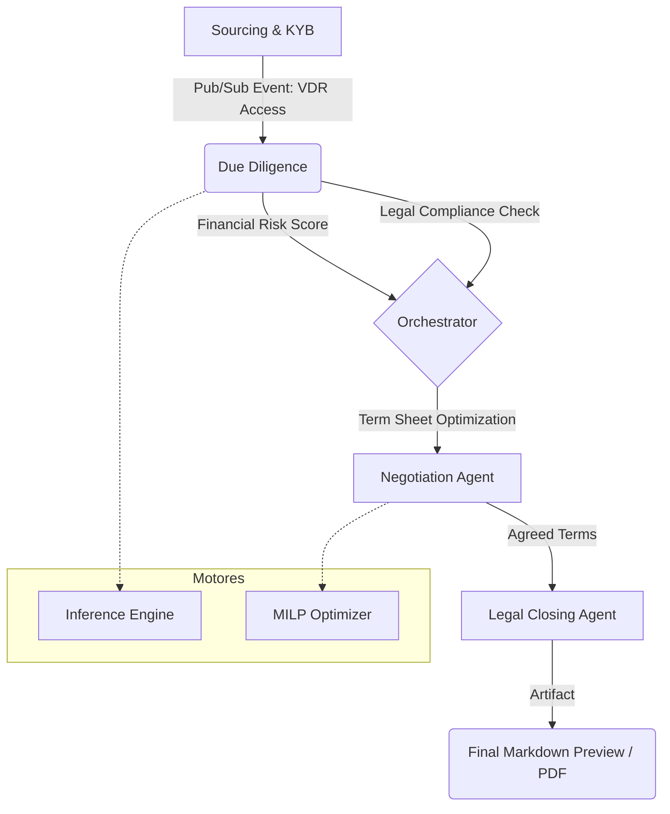

# M&Ai - MVP Monolítico

Middleware de arquitetura "low-touch" projetado em **Deno** para automatizar, otimizar e desintermediar o ciclo de vida de transações de Fusões e Aquisições (M&A), com foco nos mercados *middle-market* e *lower-middle-market*.

O projeto combina a produtividade e a segurança do TypeScript no ecossistema Deno com motores de alta performance (WASM / ONNX) e uma avançada camada agêntica suportada pelo ADK e framework Mastra.

---

## 📐 Estrutura do Monolito

O repositório é organizado de forma modular, preparando o terreno para futura separação em microsserviços e implantação corporativa na Google Cloud Platform (GCP).

```
src/
├── agent/                  # Camada agêntica (ADK TypeScript / Mastra)
│   ├── agents/             # Definição dos 7 Agentes de M&A
│   ├── workflows/          # Pipelines determinísticos e validação Zod
│   ├── context/            # Adaptadores para VDR, Engines e DB
│   ├── actions.ts          # As 5 Ferramentas Globais do ADK
│   └── index.ts            # Ponto de entrada central do ecossistema
├── cli/                    # Interface interativa de linha de comando e preview
├── core/                   # Lógica de negócio, conexões e barramento
│   ├── db/                 # Persistência Postgres, schema SQL e Memory Service
│   ├── pubsub.ts           # Barramento local assíncrono (simulador Pub/Sub)
│   └── vdr.ts              # Integração de Core API para Virtual Data Rooms
└── engines/                # Motores de computação pesada
    ├── prediction/         # IA preditiva, classificadores ONNX e Transformers
    ├── optimization/       # Otimização matemática (MILP e Algoritmos Genéticos)
    └── document-generator/ # Geração de contratos em PDF (pdf-lib) e LaTeX
```

---

## 🤖 O Ecossistema Agêntico (ADK TypeScript)

A inteligência da aplicação reside no `src/agent/`, estruturada em **7 Agentes Especializados** que compartilham acesso universal ao VDR, Engines e Banco de Dados:

1. **`BrokerOrchestratorAgent`**: Orquestrador principal. Supervisiona o fluxo e separa ativamente conhecimentos de domínio (*Domain Knowledge*) de preferências do usuário (*User Preferences*) no Database Memory Service.
2. **`SourcingAndKYBAgent`**: Conduz a qualificação de contrapartes. Vai além dos dados cadastrais e dívidas fiscais (SERPRO/Receita), analisando o fator humano: cultura corporativa, movimentações passadas e perfil dos negociadores.
3. **`GeneralDueDiligenceAgent`**: Canal direto do usuário para assuntos de auditoria. Orquestra e sintetiza as análises de dois subagentes especializados:
   * **`FinancialRiskAgent`**: Investiga balanços e DREs usando o motor ONNX para prever insolvência e volatilidade.
   * **`LegalDueDiligenceAgent`**: Varre RAG de VDR buscando riscos jurídicos e cláusulas de *Change of Control*.
4. **`DealMatchingAgent`**: Responsável pela modelagem de propostas financeiras. Prioriza faixas flexíveis de negociação (*valuation ranges*) para poupar as partes de desgaste desnecessário (*deal fatigue*).
5. **`NegotiationAgent`**: Conselheiro estratégico iterativo. Nunca dita termos finais; apresenta sempre 3 ou mais cenários de oportunidade (permuta entre *Cash*, *Equity*, *Earn-outs* e *Escrow*).
6. **`LegalClosingAgent`**: Emissor formal de documentos. Exibe uma visualização prévia estruturada do contrato em Markdown no terminal da CLI, aguardando aprovação prévia do usuário (HITL) antes de compilar os binários.

### As 5 Integrações do ADK (`src/agent/actions.ts`)
As ferramentas globais foram totalmente conectadas a implementações reais para evitar dependência de mocks:
* **`Google Cloud Pub/Sub tool`**: Conectada ao `LocalPubSubBus` no runtime do Deno para simular o tráfego do Cloud Pub/Sub de forma local e determinística.
* **`MCP Toolbox for Databases tool`**: Conectada com o repositório PostgreSQL real (`DatabaseMemoryService`).
* **`Hugging Face MCP tool`**: Realiza inferência nativa local consumindo a arquitetura ONNX/Transformers do sistema.
* **`Gemini API Google Search tool`**: Habilitada com _grounding_ real do Google Search via Gemini 3.1 Pro.
* **`Database Memory Service`**: Integrado ativamente para ler e escrever memórias persistentes durante a execução dos workflows.

Todos os agentes foram padronizados para rodar exclusivamente no modelo **Gemini 3.1 Pro** via `@ai-sdk/google`.

---

## 🗄️ Persistência de Dados (PostgreSQL)

A aplicação faz uso do PostgreSQL (`src/core/db/`) para garantir o isolamento fiduciário e rastreabilidade:
* **Tabelas Operacionais:** `transaction`, `business`, `financial_structure`, `advisor`, etc.
* **Histórico Operacional (`phase_history`):** Exclusivo para o andamento e status do M&A deal flow em formato JSONB.
* **`Database Memory Service`:** Separação limpa em tabelas próprias para guardar preferências do usuário e inteligência cultural, preparadas para futuras consultas via `pg_vector`.

---

## ☁️ Nota Arquitetural de Evolução (GCP)

Este MVP monolítico foi desenhado sob princípios de forte desacoplamento (ex: comunicação Core <-> Agentes via mensageria assíncrona em `pubsub.ts`) com o objetivo de garantir uma futura transição sem atritos para a Google Cloud Platform (GCP).

Na fase corporativa (pós-MVP), a infraestrutura evoluirá para:
* **Entrada:** Cloud Load Balancing e Cloud API Gateway.
* **Comunicação:** Google Cloud Pub/Sub orquestrando requisições de VDR à Core API e acionamento de Engines.
* **Execução & AI:** Engines hospedadas no Cloud Run; Camada Agêntica executada via endpoints seguros da Vertex AI e BigQuery.
* **Persistência:** Cloud Storage para documentos/ONNX e Postgres em Replica Pool (Master/Slaves) com suporte vetorial.

---

## 🔄 Fluxo End-to-End (E2E)

A aplicação processa o ciclo de vida da transação em etapas assíncronas através dos agentes:



**Artefatos Gerados:**
- **Sourcing Report**: Qualificação da empresa e reputação.
- **Risk Score**: Score quantitativo preditivo de falência gerado pelo modelo ONNX local.
- **Legal Summary**: Análise jurídica via RAG baseada em documentos locais.
- **Closing Preview**: Markdown estruturado exibido ao usuário com os termos finais antes da geração do PDF.

## 📖 Sumário do Conhecimento Adicional

Para permitir uma compreensão imediata das especificidades técnicas do middleware antes de abrir o código-fonte, organizamos o conhecimento central por domínios estruturais da aplicação:

### 🧠 Inteligência Artificial e Orquestração
O coração do sistema é o **Ecossistema Agêntico** (`AGENTS.md`), que coordena 7 agentes especializados (desde *Sourcing* até *Legal Closing*) através do framework Mastra. Eles operam de forma isolada, porém integrada, acessando ferramentas globais como `Google Search`, `MCP PostgreSQL` e inferência local via Hugging Face Transformers. 

Para proteger as informações fiduciárias das transações, a inteligência conta com um modelo de **RAG Silado** (`continuous_learning_and_rag.md`). Os dados dos clientes nunca se misturam; eles são estritamente filtrados por ID de transação e armazenados no PostgreSQL (`pgvector`) para viabilizar buscas semânticas seguras e permitir que o motor de aprendizado contínuo guarde as preferências do usuário.

### ⚙️ Motores de Otimização e Negociação
A tomada de decisão automatizada é sustentada por três motores matemáticos essenciais:
* **Seleção de Portfólio (MILP)** (`optimization_portfolio_solver.md`): Utiliza programação linear mista para selecionar a melhor cesta de aquisições, respeitando limites rígidos de orçamento e exclusões mútuas.
* **Criação de Term Sheets (Genético)** (`term_sheet_genetic_optimizer.md`): Um algoritmo genético que busca o Equilíbrio de Nash simulando propostas. Ele evolui cenários (dinheiro, equity, earn-out) focando em maximizar o acordo entre as partes.
* **Filtro de Governança (CP)** (`constraint_negotiation_api.md`): Submete as propostas geradas à programação por restrições, eliminando cenários que violem métricas como alavancagem de dívida (`LeverageConstraint`) e regras de compliance (`KycConstraint`).

### 📊 Modelagem Financeira e Machine Learning
A precisão na análise dos negócios é garantida por regras determinísticas e por predição baseada em redes neurais:
* **Valuation Determinístico** (`valuation.md`): O sistema aplica 6 métodos clássicos e infalíveis de cálculo (como *DCF*, *Múltiplos de EBITDA* e *Enterprise Value*).
* **Motor Preditivo ONNX** (`prediction_engine.md` e `onnx_bootstrapper.md`): Para avaliar a saúde financeira em frações de segundo, um modelo de *Deep Learning* (treinado em GPU no Colab e exportado para `.onnx` em 8-bits) é carregado na memória do Deno. Ele gera um score preditivo de insolvência que é traduzido para as métricas clássicas de Altman Z-Score.

### 🔌 Infraestrutura, Segurança e Interfaces
Para suportar toda essa inteligência de forma auditável, o M&Ai foi desenhado sob uma arquitetura resiliente:
* **Conectividade Segura** (`vdr_integration_supergood.md` e `database_memory_singleton.md`): O tráfego para os Virtual Data Rooms é blindado pelo proxy **Supergood** para auditoria. A persistência no PostgreSQL segue um estrito padrão Singleton, garantindo que os agentes não esgotem o pool de conexões durante as execuções paralelas.
* **Visualização Web** (`nextjs_gui_and_api.md`): Toda interação pode ser feita pelo painel em Next.js, que se comunica com o Deno via uma `ApiClient` protegida contra vazamento de caminhos e com suporte nativo a respostas via streaming (SSE).
* **O Caminho para a Nuvem** (`architecture.md`): O monolito atual foi intencionalmente construído com mensageria assíncrona (simulando Pub/Sub) preparando sua migração natural para serviços Serverless da GCP (Cloud Run, Vertex AI e Cloud SQL).

---

## 🚀 Como Executar

### Pré-requisitos
Certifique-se de que o Deno está instalado no sistema.
```bash
curl -fsSL https://deno.land/install.sh | sh
```

### Testes Automatizados
A suíte de testes unitários integrada cobre todos os motores computacionais e as regras de negócio:
```bash
deno task test
# ou diretamente:
deno test --allow-read --allow-write --allow-env --allow-ffi
```

### Inicializando a Interface CLI
A CLI permite navegação interativa e execução de comandos diretos para interagir com cada agente especializado e pré-visualizar contratos:
```bash
deno task start
```

---

## 📚 Documentação Adicional

* **Arquitetura Geral:** Consulte 👉 **[context/architecture.md](file:///home/luis/mai/context/architecture.md)**
* **Integração Google AI & ADK:** Consulte 👉 **[AGENTS.md](file:///home/luis/mai/AGENTS.md)**
* **Regras de Valuation e Precificação:** Consulte 👉 **[context/valuation.md](file:///home/luis/mai/context/valuation.md)**
* **Otimizador de Portfólio (MILP):** Consulte 👉 **[context/optimization_portfolio_solver.md](file:///home/luis/mai/context/optimization_portfolio_solver.md)**
* **Otimizador de Term Sheet (Algoritmo Genético):** Consulte 👉 **[context/term_sheet_genetic_optimizer.md](file:///home/luis/mai/context/term_sheet_genetic_optimizer.md)**
* **Integração VDR & Supergood Proxy:** Consulte 👉 **[context/vdr_integration_supergood.md](file:///home/luis/mai/context/vdr_integration_supergood.md)**
* **RAG Silado e Aprendizado Contínuo:** Consulte 👉 **[context/continuous_learning_and_rag.md](file:///home/luis/mai/context/continuous_learning_and_rag.md)**
* **Interface Gráfica Next.js & API:** Consulte 👉 **[context/nextjs_gui_and_api.md](file:///home/luis/mai/context/nextjs_gui_and_api.md)**
* **Inicialização e Runtime ONNX (WASM):** Consulte 👉 **[context/onnx_bootstrapper.md](file:///home/luis/mai/context/onnx_bootstrapper.md)**
* **Otimização de Negociação com Restrições:** Consulte 👉 **[context/constraint_negotiation_api.md](file:///home/luis/mai/context/constraint_negotiation_api.md)**
* **Padrão Singleton do Banco de Dados:** Consulte 👉 **[context/database_memory_singleton.md](file:///home/luis/mai/context/database_memory_singleton.md)**
* **Motor Preditivo ONNX & Treinamento:** Consulte 👉 **[docs/prediction_engine.md](file:///home/luis/mai/docs/prediction_engine.md)**


### Cloud SQL e pg_vector
Para ativar o suporte a busca vetorial no Cloud SQL, execute no console do banco de dados:
```sql
CREATE EXTENSION IF NOT EXISTS vector;
CREATE INDEX IF NOT EXISTS idx_user_preferences_hnsw ON user_preferences USING hnsw (embedding vector_cosine_ops);
```
O código da aplicação já está otimizado para identificar a presença da extensão de forma resiliente.
## Arquitetura de Orquestração
Veja [docs/architecture.md](docs/architecture.md) para detalhes do fluxo Pub/Sub e persistência de checkpoints.
