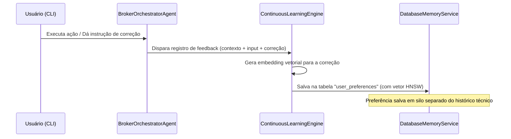

# RAG Silado e Aprendizado Contínuo (Continuous Learning)
## Especificação Técnica da Camada de Inteligência e Memória

Este documento descreve como o M&A Low-Touch Middleware gerencia o processamento de linguagem natural (NLP), a segmentação fiduciária de informações de clientes (silos de RAG) e o sistema de aprendizado contínuo que armazena memórias no PostgreSQL.

---

## 1. RAG Silado de Clientes (`ClientSiloedRAG`)

Para garantir sigilo fiduciário estrito (essencial em fusões e aquisições), o sistema implementa a classe `ClientSiloedRAG` (`src/agent/rag_layer.ts`). 

### Arquitetura de Isolamento
Cada transação ou cliente possui um identificador único (`clientId` ou `transactionId`).
- **Segregação de Índices:** Os vetores e fragmentos de texto (chunks) indexados no PostgreSQL são vinculados e filtrados obrigatoriamente por essa chave identificadora.
- **Vazamento Zero:** Um agente analisando a due diligence do Cliente A **nunca** terá acesso aos fragmentos vetoriais indexados do Cliente B nas consultas à tabela de vetores.

---

## 2. Aprendizado Contínuo (Continuous Learning Engine)

Localizado em `src/agent/continuous_learning.ts`, o motor de aprendizado contínuo permite que o sistema capture o feedback humano (HITL - Human in the Loop) gerado durante as interações na CLI e atualize de forma autônoma a base de dados de preferências.

### Fluxo de Captura de Feedback


### O Database Memory Service (`DatabaseMemoryService`)
A persistência dessas preferências de aprendizado contínuo ocorre no PostgreSQL.
- O banco utiliza tabelas como `user_preferences` e `domain_knowledge` que possuem uma coluna `embedding` do tipo `vector` (provido pela extensão `pgvector`).
- **Recuperação Contextual:** Quando um agente inicia uma tarefa, o `BrokerOrchestratorAgent` realiza uma busca de similaridade de cosseno (Cosine Similarity) na tabela `user_preferences` usando a instrução atual. As preferências mais similares do usuário são extraídas e injetadas no prompt do agente de forma transparente, permitindo que ele aprenda com os erros passados.
- **Índice HNSW:** Para manter a performance em larga escala de dados, a busca vetorial utiliza um índice HNSW (Hierarchical Navigable Small World):
  ```sql
  CREATE INDEX IF NOT EXISTS idx_user_preferences_hnsw 
  ON user_preferences USING hnsw (embedding vector_cosine_ops);
  ```
