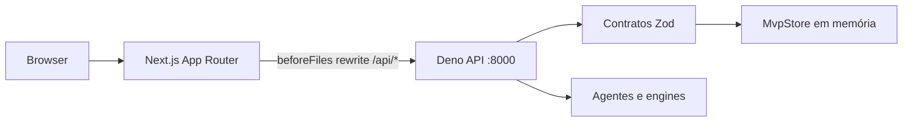

# GUI Next.js e API Deno — contexto do MVP_6

Este documento é a referência de runtime para as quatro famílias de tela do
MVP_6. O frontend fica em `gui/`; os contratos, store e roteador do adaptador
ficam em `src/api/contracts.ts`, `src/api/mvp_store.ts` e
`src/api/mvp_routes.ts`.

As três entradas são fachadas públicas e devem permanecer estáveis:

```text
src/api/
├── contracts.ts       # reexporta contracts/index.ts
├── contracts/         # DTOs e envelopes por domínio
├── mvp_store.ts       # compõe repositórios e preserva a API MvpStore
├── store/             # estado, seed, erros e repositórios por domínio
├── mvp_routes.ts      # aplica handlers na ordem de precedência
└── routes/            # handlers, helpers e dependências injetáveis
```

Consumidores externos e testes de integração importam somente as fachadas. Os
módulos internos podem evoluir sem alterar os caminhos públicos. Novos handlers
devem ser inseridos conscientemente no array ordenado de `mvp_routes.ts`, pois a
precedência de matching faz parte do comportamento HTTP.

## 1. Fluxo de requisição



O browser chama apenas caminhos relativos `/api/*`. `gui/next.config.ts` usa
`MAI_API_BASE_URL`, com padrão `http://127.0.0.1:8000`, para encaminhá-los ao
Deno. Isso evita misturar URLs internas nos componentes e garante que o novo
adaptador tenha precedência sobre route handlers legados do Next.js.

## 2. Famílias e rotas verificadas

- Dashboard/deals: `/`, `/deals`, `/deals/[id]`.
- Entity CRUD: `/entities`, `/entities?role=...`, `/entities/[id]`.
- Agentic workspace: `/deals/[id]/chat`.
- Custom dashboard: `/dashboard/custom`.
- Compatibilidade: `/clients` redireciona para `/entities`.

Todas usam `AppShell`, Sidebar de 256px/80px, TopBar de 72px e os mesmos tokens
Mastercard Editorial. Loading, empty, error, modal, validation, success e os
estados de interação relevantes preservam a geometria da família.

## 3. Contratos HTTP do MVP_6

Todos os erros usam envelope estável com `error.code`, `error.message` e erros
de campo opcionais. Listas usam `data` e `meta`; recursos usam `data`.

| Domínio | Endpoints |
| --- | --- |
| Entities | `GET/POST /api/entities`; `GET/PATCH/DELETE /api/entities/:id` |
| Team | `GET /api/team-members`; `GET/PUT /api/deals/:id/team-assignments` |
| Deals | `GET/POST /api/deals`; `GET/PATCH/DELETE /api/deals/:id`; `POST /api/deals/:id/phase-transitions` |
| Chat | `GET/POST /api/deals/:id/chat/threads`; `GET .../messages`; `POST .../stream` |
| Engines/VDR | `GET/POST /api/deals/:id/engine-runs`; `GET .../vdr-documents`; `POST .../documents` |
| Notifications | `GET /api/notifications`; `PATCH /api/notifications/:id` |
| Layout | `GET/PUT/DELETE /api/users/me/dashboard-layouts/:slug` |

Updates de deals, entidades, assignments e layouts usam versão otimista. Um
conflito preserva a edição local e oferece recarga explícita; o cliente nunca
sobrescreve silenciosamente.

## 4. Streaming agêntico

O chat usa `POST` com resposta `text/event-stream`; texto de prompt nunca é
colocado na URL. Os eventos tipados cobrem mensagem aceita, deltas, início/fim
de tool, citações, conclusão e falha. O cliente mantém `clientMessageId` e
`Last-Event-ID` durante reconexões limitadas, permite abortar a resposta e não
transforma uma falha em sucesso.

## 5. Persistência e limites

- `MvpStore` é em memória e reinicia com o processo da API.
- A integração PostgreSQL do domínio continua existente, mas ainda não é a
  persistência dessas novas rotas do protótipo.
- Autenticação e autorização estão fora do MVP_6.
- Team Activity do custom dashboard é conteúdo somente de protótipo. O tipo de
  widget `agent_entry` não implica um contrato de feed persistente.
- Sem chave Gemini, os agentes executam em modo DRY-RUN/FALLBACK.
- Downloads VDR retornam metadados/URLs controlados e nunca caminhos do servidor.

## 6. Verificação de referência

O gate final validou build de produção, TypeScript, lint dos arquivos alterados,
29 testes frontend, 25 testes de API, 12 testes de otimização, prompt Stitch e
oito rotas em produção a 2560×1440 sem erros de console.

Os testes de API espelham a estrutura modular em `tests/api/contracts/`,
`tests/api/store/` e `tests/api/routes/`, com fixtures comuns em
`tests/api/support/`. O gate da modularização preserva os 25 casos originais.

Consulte também:

- `gui/docs/stitch-component-version-contract.md`
- `gui/docs/backend-capability-matrix.md`
- `gui/docs/stitch-master-prototype-prompt.md`
- `gui/docs/prototype-state-map.md`
