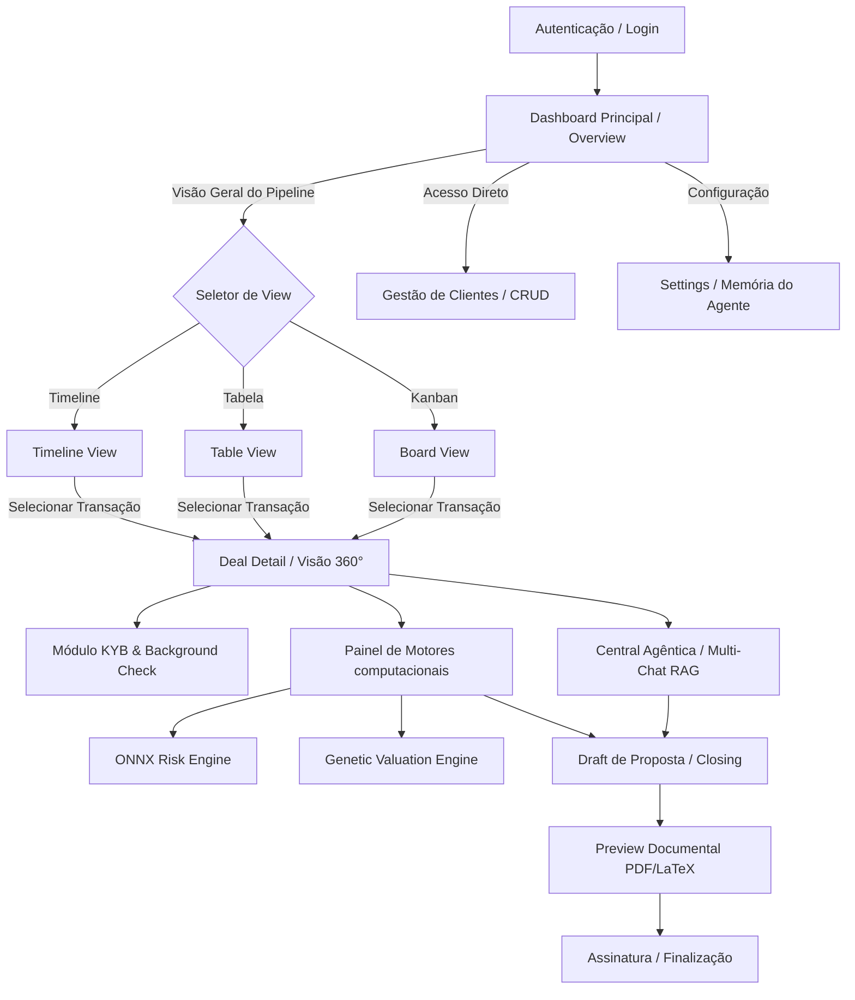

# M&Ai User Flow & Routing Architecture (MAI-49)

> **Protótipo de Validação no Stitch MCP**: Projeto `1310231555884111730` (Mastercard Editorial Design System)  
> **Arquitetura de Layout**: Application Shell com Sidebar flutuante (`Ink Black`), Topbar Contextual e Área de Conteúdo Stadium (`40px radius`).

---

## 1. Mapeamento de Jornadas do Usuário (Banker / Advisor)

---

## 2. Hierarquia de Rotas do Next.js App Router

| Rota | Tipo | Módulo / Propósito | Componentes Reutilizados |
|---|---|---|---|
| `/` | `Static` | Dashboard Principal (Board/Kanban, Table, Timeline) | `Sidebar`, `TopBar`, `DealCard`, `MetricsPill` |
| `/deals/[id]` | `Dynamic` | Detalhe da Transação (KYB, Fases, Overview) | `Sidebar`, `TopBar`, `StatusBadge`, `VDRViewer` |
| `/deals/[id]/chat` | `Dynamic` | Chat Agêntico RAG (Multi-Agent Copilot) | `ChatWindow`, `MessageBubble`, `InputBar` |
| `/deals/[id]/engines` | `Dynamic` | Painel de Insights ONNX (Risco) e MILP/Genético | `EngineGauge`, `ValuationChart`, `InsightsList` |
| `/clients` | `Static` | Gestão de Clientes (CRUD Buyers/Sellers) | `DataTable`, `ClientFormModal`, `SearchPill` |
| `/settings` | `Static` | Configurações Globais & Memória de Cultura | `SettingsTabs`, `PreferenceForm`, `Badge` |

---

## 3. POV Switching (Pontos de Vista Contextuais)

A interface suporta 3 modos de perspectiva selecionáveis no indicador flutuante da Topbar:
1. **Instituição (M&A Advisory)**: Visão consolidada de todas as transações, métricas agregadas da carteira e alocação de equipe.
2. **Banker / Usuário (Padrão)**: Foco nos deals atribuídos ao usuário logado, inbox de tarefas prioritárias e assistente pessoal agêntico.
3. **Cliente (Buyer/Seller)**: Visão restrita e sanitizada da transação específica do cliente, status do VDR e aprovação de documentos.
