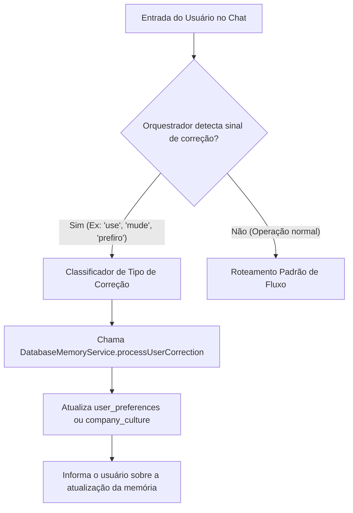

# Guia de Gestão e Captura de Preferências do Broker

Este guia estabelece as diretrizes de engenharia, comportamento agêntico e
fluxos de integração necessários para que o `BrokerOrchestratorAgent`
intercepte, interprete e persista correções de usuários de forma segura,
alimentando o **Database Memory Service** do ecossistema de M&A (**M&Ai**).

---

## 1. Captura e Intercepção de Correções do Usuário

Durante as sessões do Agentic Workspace e nas interações aprovadas pela API,
os brokers emitem correções linguísticas diretas (ex: _"Não, use múltiplos de
10x EBITDA para tecnologia, não de 8x"_ ou _"Trabalhe com o WACC de 12% de agora
em diante"_). O Orquestrador tem o dever cognitivo de identificar essas
alterações em tempo real.



### Protocolo de Detecção Cognitiva

O orquestrador intercepta a entrada do usuário buscando marcadores semânticos de
modificação de parâmetros de negócio. Ao identificá-los, ele suspende
temporariamente o fluxo normal e desvia a execução para a ferramenta de ingestão
de memória.

---

## 2. Fluxo de Ingestão de Preferências no Database Memory Service

O `DatabaseMemoryService` disponibiliza a gravação segregada por meio do método
`processUserCorrection`. Toda ingestão deve respeitar o seguinte mapeamento
estrutural:

### Tabela de Mapeamento de Modificações

| Entrada do Usuário                                                         | Classificação do Tipo                          | Destino no Banco de Dados                              | Chave/Categoria Usada                               |
| :------------------------------------------------------------------------- | :--------------------------------------------- | :----------------------------------------------------- | :-------------------------------------------------- |
| "Nossos deals de tecnologia sempre usam WACC de 11.5%."                    | `user_preference`                              | Tabela `user_preferences`                              | `preferences -> 'wacc_tech'`                        |
| "A empresa-alvo 'Alfa S/A' tem alta dependência do diretor comercial."     | **Target Dossier (Proposta)**                  | Sub-objeto `cultureProfile` em `targetDossierProposal` | _Não é memória; pertence ao Target Dossier do deal_ |
| "Pelas regras tributárias atuais, o Split Payment retém X% imediatamente." | **Tentativa de Alteração de Regra de Mercado** | Bloqueado pelo Orquestrador                            | _Rejeitado para evitar corrupção da base global_    |

---

## 3. Diretrizes de Engenharia de Prompt e Injeção de Contexto

Para que os subagentes especializados (como o de Valuation ou o Financeiro)
trabalhem respeitando as preferências do Broker e as regras universais coletadas
no RAG, o `BrokerOrchestratorService` deve injetar dinamicamente no prompt de
sistema de cada agente o contexto carregado no início da transação.

### Template de Prompt para Injeção Dinâmica

```markdown
# CONTEXTO DE DIRETRIZES DO ORQUESTRADOR

Você está executando uma ação delegada pelo BrokerOrchestratorAgent para o Deal
ID: [DEAL_ID]. Abaixo constam as diretrizes normatizadas que devem orientar
estritamente o seu raciocínio.

## 1. Conhecimento Universal de Domínio (Domain Knowledge)

Essas regras são imperativas e não podem ser ignoradas sob qualquer pretexto:
{{DOMAIN_KNOWLEDGE_CONTEXT}}

## 2. Preferências do Usuário Broker (User Preferences)

Adapte seu estilo e parâmetros de cálculo para respeitar estas diretrizes de
negócios do broker, desde que não violem a conformidade descrita nas regras de
domínio acima: {{USER_PREFERENCES_CONTEXT}}

---

# INSTRUÇÃO ESPECÍFICA DE TRABALHO

Aja estritamente com base nos dados do VDR e aplique os contextos fornecidos.
Caso ocorra conflito técnico irreconciliável entre as Preferências do Usuário e
as Regras de Domínio, emita obrigatoriamente um alerta contendo a tag:
[COMPLIANCE_CONFLICT].
```

---

## 4. Protocolo de Detecção de Conflitos e Override

Caso o broker tente impor uma preferência que conflite diretamente com as leis
federais ou padrões técnicos de compliance (ex: desconsiderar as obrigações da
Reforma Tributária LC 214/2025 para inflar o fluxo de caixa projetado no
valuation), o Orquestrador deve executar o seguinte procedimento de segurança:

1. **Bloqueio de Ingestão de Domínio:** O Orquestrador bloqueia qualquer
   alteração nas regras globais.
2. **Gravação da Preferência sob Alerta:** A preferência é salva na tabela
   `user_preferences` com uma flag de conformidade:
   `{"bypass_regulatory_checks": true}`.
3. **Emissão de Alerta Crítico:** A camada de aplicação deve registrar um aviso
   estruturado e a superfície Agentic Workspace deve exibi-lo em Markdown com o
   formato de alerta do conselho de administração:

> [!WARNING]
> **ALERTA DE CONFORMIDADE CRÍTICA (HITL REQUIREMENT)** A preferência de ignorar
> as contingências fiscais e os impactos do Split Payment da LC 214/2025 foi
> registrada. No entanto, o motor de predição financeira (`FinancialRiskAgent`)
> continuará gerando a estimativa de risco real utilizando a matriz oficial de
> contingências CPC 25. Esta transação está classificada como **ALTO RISCO** e
> não poderá avançar para a fase de fechamento de SPA (`LegalClosingAgent`) sem
> a aprovação explícita e assinatura eletrônica do Diretor de Compliance.

```
```
