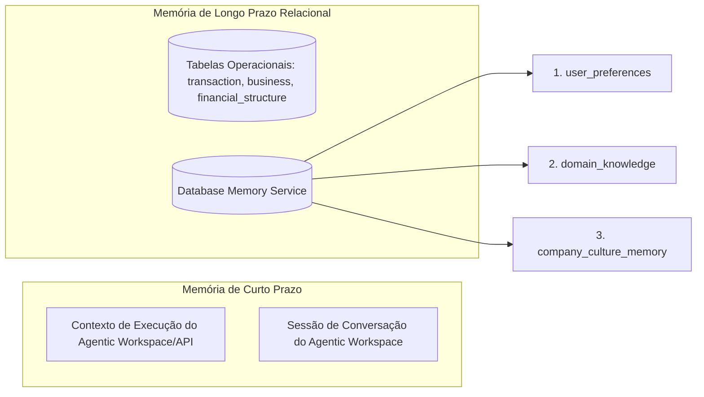

# Taxonomia de Memória para Fusões e Aquisições (M&A)

Este documento define a taxonomia estruturada para o armazenamento, organização
e recuperação de memórias de curto e longo prazo no **Database Memory Service**
do ecossistema de M&A. O objetivo é garantir o isolamento fiduciário,
conformidade regulatória e a personalização de atendimento ao broker sem
comprometer ou contaminar o conhecimento corporativo global da plataforma.

---

## 1. Arquitetura da Memória: Curto Prazo vs. Longo Prazo

O middleware opera sob uma arquitetura de persistência de memória híbrida,
segregando dados de tráfego de dados de estado operacional e preferências
históricas.



- **Curto Prazo (Short-Term Memory):** Retida em variáveis de runtime e no
  histórico de mensagens da sessão ativa no Agentic Workspace. Serve para
  manter a coerência imediata do diálogo.
- **Longo Prazo (Long-Term Memory):** Persistida no PostgreSQL de forma
  segregada. Divide-se em:
  1. **Estado Operacional:** Registrado estritamente na tabela `phase_history`
     (rastreabilidade de workflows de M&A).
  2. **Memória de Negócio e Conhecimento:** Armazenada nas tabelas do
     `Database Memory Service`, com suporte à busca vetorial via embeddings de
     1536 dimensões (preparado para `pg_vector`).

---

## 2. Categorias da Taxonomia de Memória

Para a correta indexação e recuperação via RAG, a memória de longo prazo é
segmentada em cinco categorias taxonômicas:

### A. Preferências do Usuário (User Preferences)

- **Localização:** Tabela `user_preferences` (`preferences` - JSONB).
- **Descrição:** Configurações, estilos e orientações específicas adotadas por
  um broker ou assessor de investimento específico.
- **Exemplos de Chaves:**
  - `defaultValuationMethod`: Método predileto (ex: "DCF", "EBITDA_Multiples").
  - `riskAppetite`: Nível de tolerância ao risco cadastral ou financeiro (ex:
    "Conservative", "Moderate", "Aggressive").
  - `valuationCeilings`: Múltiplos de EBITDA máximos aceitáveis para alvos não
    operacionais.
  - `preferredJurisdictions`: Estados prioritários (ex: "São Paulo", "Rio de
    Janeiro") para evitar disputas fiscais estaduais (IBS).

### B. Conhecimento de Domínio (Domain Knowledge)

- **Localização:** Tabela `domain_knowledge` (`knowledge` - JSONB).
- **Descrição:** Regras de mercado imutáveis, normativas legais nacionais,
  fórmulas econômicas validadas e regras regulatórias.
- **Exemplos de Chaves:**
  - `brazilian_tax_laws`: Diretrizes da transição tributária da Reforma
    Tributária (LC 214/2025) e funcionamento do _Split Payment_.
  - `valuation_formulas`: Modelo matemático exato do Altman Z-Score quantizado
    para o mercado brasileiro de _middle-market_.
  - `closing_covenants_standards`: Cláusulas padrão exigidas por lei ou súmulas
    do CADE (como limites de Não-Concorrência).

### C. Histórico do Deal (Deal History)

- **Localização:** Tabelas relacionais do banco (`transaction`,
  `financial_structure`, `phase_history`).
- **Descrição:** O registro imutável do que ocorreu nas fases da transação.
  Salva os dados financeiros consolidados de auditorias passadas, propostas
  recusadas na mesa de negociação e contratos finais gerados.

### D. Perfil do Cliente e Cultura da Target (Client Profile & Target Culture)

- **Localização:** Tabela `company_culture_memory` (`culture_data` - JSONB).
- **Descrição:** Análise qualitativa e relatórios OSINT sobre o comportamento
  dos tomadores de decisão da empresa-alvo e governança.
- **Exemplos de Chaves:**
  - `negotiatorStyle`: Perfil psicológico do ponto de contato (ex: "Aggressive
    seller", "Technical advisor").
  - `founderDependency`: Nível de dependência técnica ou operacional que a
    empresa possui sobre os fundadores originais.
  - `esgFrictionRisk`: Indícios de desalinhamento de governança e histórico
    sindical.

### E. Guardrails de Transação (Transaction Guardrails)

- **Localização:** Estrutura estática de regras (`rules.md` e schemas Zod)
  aliada a restrições em `domain_knowledge`.
- **Descrição:** Políticas mandatórias que barram a execução de ações de alto
  risco de forma autônoma (ex: proibição de assinatura automática de SPA sem
  intervenção humana, limites de alçada financeira).

---

## 3. Regras de Atualização e Segregação Fiduciária

Para evitar contaminação do conhecimento comum e vazamento de dados
confidenciais entre transações distintas (Garantia de Silos Fiduciários), são
estabelecidas as seguintes regras:

> [!IMPORTANT]
> **Regra da Segregação de Escrita:** Mensagens ou correções vindas de
> interações com o broker de uma transação específica devem atualizar unicamente
> as tabelas `user_preferences` e `company_culture_memory` correspondentes
> àquele contexto. A tabela `domain_knowledge` é estritamente de **leitura**
> para a camada agêntica padrão e só pode ser escrita por administradores ou
> pipelines de atualização de infraestrutura validados.

### Regras de Resolução de Conflitos (Domain Knowledge vs. User Preferences)

Quando uma preferência do usuário ou instrução de conversação colidir com as
regras técnicas universais do Conhecimento de Domínio, o sistema adotará o
seguinte protocolo determinístico:

1. **Sobreposição Legal e Financeira:** O Conhecimento de Domínio (ex: cálculo
   correto de contingências sob CPC 25 ou regulação da Lei das S.A.) sempre
   **sobrepõe** as preferências do usuário.
2. **Exemplo Prático:** Se o Broker ordenar: _"Assuma que a contingência
   trabalhista de Pejotização é remota e ignore a provisão de R$ 5M no
   valuation"_ e o `LegalDueDiligenceAgent` classificar o passivo como
   **Provável** (com base em subordinação direta e onerosidade documentada), o
   `BrokerOrchestratorAgent` deve:
   - Respeitar a classificação técnica no relatório final de Due Diligence
     (segurança jurídica).
   - Aplicar a restrição de conformidade e emitir um **Alerta Vermelho de
     Risco** explícito no Agentic Workspace e no retorno da aplicação aprovada.
   - Impedir a geração do SPA final até que ocorra um override manual
     documentado com autenticação humana (HITL).

```typescript
// Exemplo conceitual de validação de conciliação de memória
export function validateConstraints(
  preferences: Record<string, unknown>,
  domainKnowledge: Record<string, unknown>,
): { isValid: boolean; warning?: string } {
  // Se preferência solicitar desvio de compliance
  if (preferences.bypassTaxValidation === true) {
    return {
      isValid: false,
      warning:
        "CONFLITO DE CONFORMIDADE: A preferência do broker tenta suprimir a validação de certidões fiscais, o que viola o bloco de Domain Knowledge de M&A. Ação bloqueada pelo Guardrail de Segurança.",
    };
  }
  return { isValid: true };
}
```
