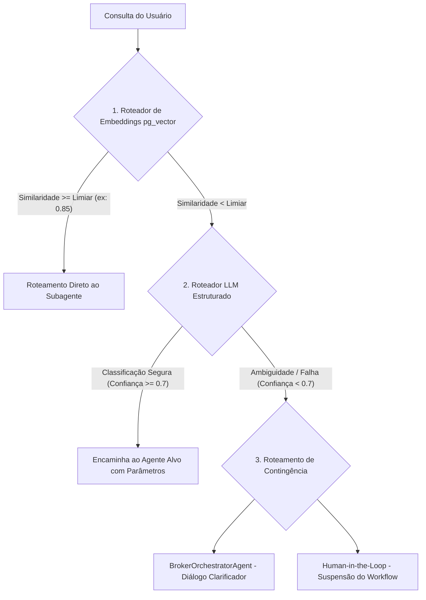

# Guia de Padrões de Roteamento Semântico para Orquestração de Agentes de M&A

Este documento estabelece as diretrizes de design, padrões arquiteturais e
implementações técnicas para o roteamento semântico de consultas no middleware
de M&A (**M&Ai**). O roteamento semântico atua como a primeira camada cognitiva
do `BrokerOrchestratorAgent`, convertendo a intenção do usuário em decisões
dinâmicas de encaminhamento para subagentes especializados, otimizando latência,
custo e precisão.

---

## 1. Classificação de Intenções (Intents) em M&A

O ecossistema é composto por agentes focados em fases críticas do ciclo de
transação. O roteador semântico deve classificar a entrada do usuário em uma das
seguintes categorias primárias:

| Intenção (Intent)        | Descrição do Domínio                                                                                                                | Agente Alvo                                                                               |
| :----------------------- | :---------------------------------------------------------------------------------------------------------------------------------- | :---------------------------------------------------------------------------------------- |
| **Sourcing & KYB**       | Análise cadastral, conformidade com a Receita Federal, busca de reputação em mídia, governança e identificação de fundadores.       | `SourcingAndKYBAgent`                                                                     |
| **Due Diligence**        | Auditoria profunda do Virtual Data Room (VDR), análise de balanços, busca de passivos societários, trabalhistas ou tributários.     | `GeneralDueDiligenceAgent` (Delega para `FinancialRiskAgent` ou `LegalDueDiligenceAgent`) |
| **Valuation & Matching** | Otimização de portfólio de aquisições (MILP), modelagem de DCF, múltiplos de EBITDA e desconto de iliquidez.                        | `DealMatchingAgent`                                                                       |
| **Negotiation**          | Simulação de cenários de propostas (Cash vs. Equity vs. Earn-out), ZOPA, BATNA e estruturação de Term Sheets.                       | `NegotiationAgent`                                                                        |
| **Legal Closing**        | Elaboração formal do SPA, validação de cláusulas limitadoras de responsabilidade (Reps & Warranties), Non-Compete e emissão física. | `LegalClosingAgent`                                                                       |

---

## 2. Padrões Arquiteturais de Roteamento Semântico

Para equilibrar velocidade (latência < 5ms em hits exatos) e robustez semântica
em consultas ambíguas, o middleware adota uma arquitetura de **Roteamento
Híbrido de Três Níveis**.



### Padrão A: Roteamento Baseado em Vetores (pg_vector / Hugging Face)

- **Conceito:** O texto de entrada do usuário é convertido em um vetor de
  embedding. Uma consulta é feita no PostgreSQL contra frases conhecidas
  (utterances de teste) armazenadas na tabela `domain_knowledge` (categoria:
  `routing_utterances`).
- **Vantagem:** Latência extremamente baixa (menor que 10ms) e custo nulo de
  tokens LLM.
- **Mecanismo:** Utiliza distância de cosseno (`<=>` no pg_vector) para
  encontrar a melhor correspondência.

### Padrão B: Roteador LLM Estruturado (Gemini + Zod)

- **Conceito:** Caso o roteamento vetorial não atinja o limiar de confiança
  mínima (ex: similaridade de cossenos < 0.85), a consulta é enviada para um
  classificador LLM leve (Gemini 2.5/3.5 Flash).
- **Vantagem:** Capacidade de raciocinar sobre intenções complexas e extrair
  parâmetros estruturados (como ID da transação, CNPJ ou tipo de documento)
  simultaneamente.
- **Mecanismo:** Utiliza a chamada estruturada do Mastra/AI SDK forçando a saída
  a obedecer a um esquema Zod.

### Padrão C: Roteamento de Contingência e HITL (Human-In-The-Loop)

- **Limiar de Confiança:** Se a classificação do LLM retornar uma pontuação de
  confiança abaixo de 70% ou se houver contradição insanável, o sistema entra em
  fallback.
- **Comportamento:** O `BrokerOrchestratorAgent` assume, solicitando informações
  adicionais ("Você gostaria de revisar as cláusulas legais do SPA ou realizar a
  modelagem do valuation?"). Caso a ação envolva termos financeiros vinculantes,
  o workflow é suspenso (`.suspend()`) aguardando aprovação humana.

---

## 3. Implementações Técnicas em Deno/TypeScript

### A. Roteador Vetorial Nativo via PostgreSQL

O código a seguir demonstra o roteamento vetorial rápido utilizando o pool de
conexões PostgreSQL para verificar a correspondência semântica de uma query do
usuário.

```typescript
// src/agent/routing/vector_router.ts
import { DatabaseMemoryService } from "../../core/db/memory_service.ts";

export interface RouteResult {
  agentId: string;
  confidence: number;
}

export class VectorSemanticRouter {
  private dbMemory: DatabaseMemoryService;
  private readonly threshold = 0.82; // Limiar de confiança de cosseno

  constructor() {
    this.dbMemory = new DatabaseMemoryService();
  }

  /**
   * Executa a busca vetorial para determinar o agente de destino.
   */
  public async routeQuery(
    queryEmbedding: number[],
  ): Promise<RouteResult | null> {
    // Busca na tabela domain_knowledge contra expressões de rotas pré-cadastradas
    const results = await this.dbMemory.searchSimilarKnowledge(
      queryEmbedding,
      1,
    );

    if (results.length === 0) return null;

    const topResult = results[0];
    const similarity = topResult.similarity;

    if (similarity >= this.threshold) {
      const agentId = topResult.knowledge.target_agent as string;
      return { agentId, confidence: similarity };
    }

    return null; // Força fallback para Roteador LLM
  }
}
```

### B. Roteador LLM Estruturado usando Mastra & Zod

Quando o roteador de embeddings falha, o LLM é acionado com um esquema de saída
rigoroso.

```typescript
// src/agent/routing/llm_router.ts
import { google } from "@ai-sdk/google";
import { z } from "zod";
import { BrokerOrchestratorAgent } from "../agents/broker-orchestrator/index.ts";

export const RoutingSchema = z.object({
  targetAgent: z.enum([
    "sourcing-kyb-agent",
    "general-dd-agent",
    "deal-matching-agent",
    "negotiation-agent",
    "legal-closing-agent",
    "broker-orchestrator-agent",
  ]).describe("O identificador do agente que deve receber a tarefa."),
  extractedEntities: z.object({
    cnpj: z.string().optional().describe("CNPJ identificado no texto."),
    dealId: z.string().optional().describe("UUID ou código do deal."),
    valuation: z.number().optional().describe("Montante financeiro envolvido."),
  }),
  confidenceScore: z.number().min(0).max(1).describe(
    "Nível de certeza da classificação.",
  ),
  reasoning: z.string().describe("Breve justificativa para a decisão de rota."),
});

export class LLMSemanticRouter {
  public static async classifyQuery(
    query: string,
  ): Promise<z.infer<typeof RoutingSchema>> {
    const prompt = `
      Você é o Roteador Semântico do Broker Orchestrator para transações de M&A.
      Analise a seguinte solicitação do usuário e determine o subagente especializado ideal para respondê-la,
      extraindo quaisquer entidades relevantes mencionadas.

      Solicitação do usuário:
      "${query}"
    `;

    // Utiliza o modelo estruturado do Gemini configurado no ADK/Mastra
    const response = await BrokerOrchestratorAgent.generate(prompt, {
      output: "object",
      schema: RoutingSchema,
    });

    return response.object;
  }
}
```

---

## 4. Práticas Recomendadas para ग्राउंडing (Grounding) e RAG

- **Configuração de Frases de Rota:** Cada subagente deve ter ao menos 20
  expressões típicas (utterances) vetorizadas no banco (ex: "Calcule a
  probabilidade de falência do Target" -> `financial-risk-agent`).
- **Contexto Acumulado:** Consultas subsequentes na mesma sessão devem incluir o
  ID da transação ativa para que o roteador não perca o contexto espacial do
  deal flow.
