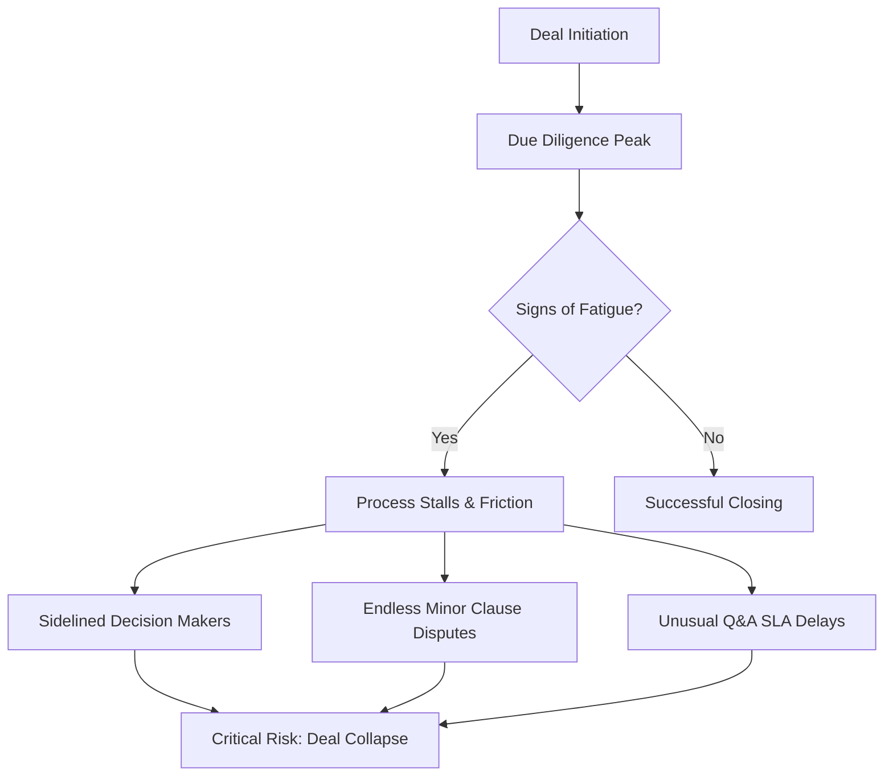

# Playbook for Deal Fatigue Mitigation in M&A Transactions

Deal fatigue (_fadiga de negociação_) is one of the leading causes of
transaction failure in middle-market M&A. This playbook defines the behavioral
and operational indicators of deal fatigue and establishes countermeasures to
maintain momentum.

---

## 1. Diagnostics: Indicators of Deal Fatigue

M&A processes are long, demanding, and stressful. Identifying the early signs of
exhaustion prevents abrupt deal termination.

### A. Q&A and Document Review Delays (SLA Breaches)

- **Symptom:** The target's management or the buyer’s analysts begin taking 5+
  business days to answer standard due diligence questions that previously took
  48 hours.
- **Underlying Cause:** Management is overwhelmed trying to run the business
  while answering transactional queries, leading to operational bottlenecks.

### B. Endless Renegotiation of Minor Clauses

- **Symptom:** Legal teams spend weeks negotiating clauses that have negligible
  economic impact (e.g., micro-definitions of _de minimis_ thresholds, specific
  indemnification baskets, or minor MAC/MAE clauses).
- **Underlying Cause:** Loss of trust or risk aversion. Parties focus on
  protecting themselves from hypothetical, minor risks rather than finalizing
  the core business terms.

### C. Advisor Replacement and Sidelined Decision Makers

- **Symptom:** Key decision-makers (Founders or C-level buyers) delegate
  meetings entirely to junior advisors or legal counsel, stopping direct
  communication. Alternatively, changing the primary legal advisor mid-deal.
- **Underlying Cause:** Executive burnout or frustration with the transaction's
  progress.

---

## 2. Mitigation Countermeasures

To combat deal fatigue, the transaction orchestrator must implement structural
and psychological interventions.

### Countermeasure 1: Rigorous Sell-Side Due Diligence

Before starting the process:

- Build a complete Virtual Data Room (VDR).
- Perform pre-due diligence on tax, legal, and financial aspects to anticipate
  issues.
- _Result:_ Reduces the number of ad-hoc requests during the buyer's DD, keeping
  the process moving.

### Countermeasure 2: Decouple Commercial and Technical Tracks

Keep decision-makers focused on the strategic vision while technical teams
handle details:

- Establish weekly commercial alignment meetings (only for Principals) to
  discuss major deal points.
- Establish daily technical standups (advisors/lawyers) to resolve legal and tax
  issues.
- _Result:_ Prevents operational friction from straining the relationship
  between the buyer and seller.

### Countermeasure 3: Implement the "Frictionless" SLA Protocol

Establish a clear Q&A protocol at the start:

- Set a **48-hour response target** for standard requests.
- Aggregate questions into weekly batches rather than sending continuous,
  fragmented requests.
- Use a traffic-light system (Red/Yellow/Green) to prioritize critical
  documents.

### Countermeasure 4: Bridge Valuation Gaps Structural Tools

When negotiation stalls on valuation, stop trying to find a single price. Move
to contingent structures:

- **Earn-outs:** Link 20%-40% of the price to post-closing EBITDA performance.
- **Vendor Loans:** The seller finances a portion of the purchase price, payable
  over 2-3 years.
- **Escrow Accounts:** Set a dedicated fund for indemnity claims, preventing
  disputes over post-closing liability adjustments.

> [!TIP]
> Keep negotiations focused on the big picture. When minor clauses stall
> progress, set a **"Time-Boxed Waiver"** where unresolved minor items are
> deferred to a joint mediation call or waived entirely if their value is below
> 1% of the total deal value.
