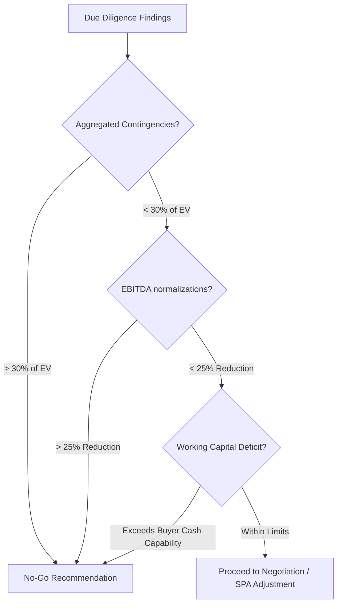

# M&A Go / No-Go Investment Criteria & Red-Line Framework
> **Target Audience:** Investment Committee, Buy-side Deal Leads, General Due Diligence Coordinators  
> **Market Focus:** Brazilian Middle-Market Acquisitions (LTDAs and S.As)

This framework defines the "Go/No-Go" investment criteria, establishing clear "red lines" (deal-breakers) and quantitative thresholds that dictate when a transaction must be aborted or structurally renegotiated.

---

## 1. Automatic Deal-Breakers (Red Lines)

The occurrence of any of the following findings during the due diligence process constitutes an immediate **No-Go** recommendation. These issues cannot be cured via standard Representations & Warranties (R&W) due to their systemic risk or legal invalidity.

### 1. Tax Fraud & Evasion (Sonegação / "Caixa Dois")
*   **Trigger:** Discovery of systemic parallel accounting (unrecorded cash operations - *Caixa Dois*), or the systematic purchase of fraudulent invoices (*Notas Frias* / *Notas Fantasmas*) to artificially reduce tax liability (IRPJ, CSLL, PIS, COFINS).
*   **Rationale:** Tax fraud is a criminal offense in Brazil (Lei nº 8.137/1990) exposing the buyer's board to personal criminal liability. The resulting tax assessment (*Auto de Infração*) includes punitive interest and fines of up to $150\%$ of the unpaid tax, which cannot be reliably estimated.

### 2. Systemic Labor "Pejotização"
*   **Trigger:** The target hires more than $40\%$ of its core workforce (essential operational staff or developers) through corporate entities (PJs), and the estimated cost of regularizing these employees under the CLT regime (including retroactive FGTS, INSS, vacation, 13th salary, and penalties) exceeds the transaction's Cap Limit or the estimated Equity Value.
*   **Rationale:** Labor courts in Brazil lean heavily toward the worker. Under the "Principle of Reality over Form" (*Princípio da Primazia da Realidade*), court recharacterization of the employment relation is highly probable, resulting in massive, non-deductible successor liabilities.

### 3. Active Environmental Crimes & Licensing Deficits
*   **Trigger:** The target is facing criminal prosecution under the Environmental Crimes Act (Lei nº 9.605/1998) or does not possess the mandatory Environmental Operating License (Licença de Operação - LO) for its primary industrial facility, with no viable path to regularization.
*   **Rationale:** Environmental liability in Brazil is objective, joint, and several (*propter rem*). It traverses corporate restructurings, allowing authorities to shut down operations and freeze the buyer's assets.

### 4. Non-Compliant UBO & Shareholder Structure
*   **Trigger:** Failure to identify the target's Ultimate Beneficial Owner (UBO) through the official **e-BEF** registry (Instrução Normativa RFB nº 2.290/2025), or finding that a key shareholder/beneficiary is a nominee ("laranja"), is listed on international sanction lists (OFAC, UN), or is under investigation by COAF/SISCOAF for money laundering.
*   **Rationale:** Exposes the buyer to immediate banking blockages (under Central Bank regulations), reputational ruin, and severe compliance violations under the Brazilian Clean Company Act (Lei nº 12.846/2013).

### 5. Unresolved Corporate Deadlocks in LTDA Structures
*   **Trigger:** The target is structured as a Limitada (LTDA) and its Contrato Social lacks the clause invoking the supletive application of the Joint-Stock Company Law (**Art. 1.053, parágrafo único, of the Brazilian Civil Code**), and a minority quotaholder (holding $>25\%$ of voting power) refuses to sign the transaction, preventing the execution of a Drag-along right.
*   **Rationale:** Without the supletive application of Lei nº 6.404/76, quotaholder agreements are difficult to enforce specifically, and the buyer cannot force a squeeze-out, leaving them locked in a corporate deadlock.

### 6. Anti-Corruption Violations (Clean Company Act)
*   **Trigger:** Due diligence uncovers evidence of bribes paid to public officials to obtain operational licenses, win public bids, or secure tax benefits, exposing the company to sanctions under **Lei nº 12.846/2013** (Lei Anticorrupção).
*   **Rationale:** The Clean Company Act imposes strict civil and administrative liability. Punishments include fines of up to $20\%$ of the company's gross revenue and the "extrajudicial dissolution" (compulsory winding-up) of the corporate entity.

---

## 2. Quantitative No-Go Thresholds

Even if no individual Red Line is crossed, the transaction must be aborted if any of the following cumulative quantitative thresholds are met:

### 1. Cumulative Contingency Cap
*   The sum of all **Provável** and **Possível** contingencies (Taxes + Labor + Civil + Environmental) exceeds **$30\%$ of the Enterprise Value**, unless the seller agrees to deduct the entire Provável portion and place the entire Possível portion in a bullet-proof Escrow Notarial (Provimento CNJ nº 197/2025).

### 2. EBITDA Normalization Limit
*   Quality of Earnings (QoE) audits result in an EBITDA reduction of **more than $25\%$** of the seller's management representations.
*   *Rationale:* Such a large reduction implies that the target's operating margins are structurally impaired, rendering the initial transaction multiple and financial model obsolete.

### 3. Net Debt & Working Capital Deficit
*   The target's working capital deficit (calculated using the average working capital of the last 12 months as the peg) exceeds the available cash buffer of the buyer, meaning the buyer would have to inject equity capital post-closing just to keep the business solvent.

---

## 3. Escalation & Action Protocol

If a Go/No-Go threshold is breached:
1.  **Immediate Warning:** The General DD Agent triggers an alert to the BrokerOrchestratorAgent.
2.  **Materiality Verification:** The Financial and Legal teams verify the mathematical calculations and legal basis.
3.  **Seller Confrontation:** If the issue is curable, the buyer presents a revised proposal demanding:
    *   Direct price reduction (EV deduction).
    *   Establishment of a **Conta Notarial Vinculada** under Provimento CNJ nº 197/2025 to hold disputed amounts.
    *   Conversion of the transaction from a Share Deal to an Asset Deal (trespasso) to isolate historical liabilities.
4.  **Formal Termination:** If the issue is incurable (e.g., active environmental crime or UBO fraud), a formal No-Go report is issued to the Investment Committee, and negotiations are terminated.
