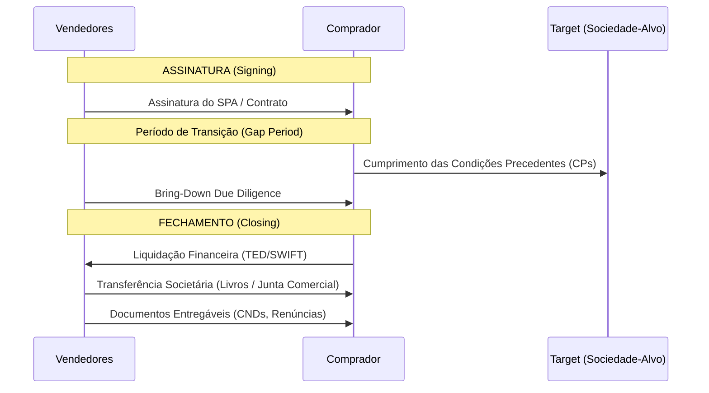

# Guia de Mecânica de Fechamento (Closing Mechanics) no M&A Brasileiro

A mecânica de fechamento estabelece os ritos e protocolos societários,
regulatórios e financeiros que formalizam a transferência de propriedade e a
liquidação financeira de uma transação de Fusões e Aquisições (M&A).

## 1. Signing vs. Closing (Assinatura vs. Fechamento)

A transação pode se dar em etapa única (fechamento simultâneo) ou em etapas
cindidas (fechamento diferido):

1. **Assinatura (Signing):** As partes celebram o Contrato de Compra e Venda de
   Ações/Quotas (SPA/QPA). Nesse momento, as partes assumem a obrigação
   vinculante de comprar e vender, mas a propriedade da Target não é
   transferida.
2. **Período de Transição (Gap Period):** Intervalo entre a assinatura e o
   fechamento. Durante esse período, as partes trabalham para satisfazer as
   Condições Precedentes (CPs). A Target deve ser gerida sob as regras de
   covenants de curso normal dos negócios (_ordinary course of business_).
3. **Fechamento (Closing):** Data em que todas as CPs são atendidas (ou
   dispensadas pelas partes), a transferência das quotas/ações é formalizada e o
   preço de compra é efetivamente liquidado.

---

## 2. Troca de Documentos e Entregáveis (Deliverables)

Na Data de Fechamento, as partes devem proceder com a troca e formalização dos
seguintes documentos (entregáveis obrigatórios):

- **Livros Societários (Sociedades Anônimas):** Assinatura dos termos de
  transferência no Livro de Registro de Ações Nominativas (LRAN) e no Livro de
  Transferência de Ações Nominativas (LTAN).
- **Alteração do Contrato Social (Limitadas):** Assinatura da Alteração de
  Contrato Social registrando a cessão e transferência de quotas, a ser
  protocolada perante a Junta Comercial do Estado competente.
- **Renúncias de Administradores:** Termos de renúncia assinados pelos atuais
  diretores e conselheiros indicados pelos Vendedores, outorgando quitação mútua
  com a Target.
- **Eleição de Novos Administradores:** Atas de Assembleia ou Reunião de Sócios
  da Target deliberando sobre a eleição dos novos diretores indicados pelo
  Comprador.
- **Certidões de Regularidade (CNDs):** Apresentação das certidões negativas de
  débitos federais, estaduais e municipais vigentes, FGTS e certidão nacional de
  débitos trabalhistas.
- **Quitações e Liberações de Gravames:** Liberação e cancelamento de quaisquer
  ônus, penhoras, garantias, alienações fiduciárias ou gravames que recaiam
  sobre as ações/quotas ou ativos da sociedade.

---

## 3. Assinatura Física vs. Digital (Legislação Aplicável)

A validade da formalização de contratos e atos societários por meio eletrônico
no Brasil é regulada por marcos normativos específicos:

- **Medida Provisória nº 2.200-2/2001:** Instituiu a Infraestrutura de Chaves
  Públicas Brasileira (ICP-Brasil). Atos assinados com certificados digitais
  padrão ICP-Brasil (como e-CPF e e-CNPJ) gozam de presunção legal de
  autenticidade, integridade e validade jurídica absoluta (equivalência a firma
  reconhecida por tabelião público).
- **Assinatura Eletrônica Avançada (Art. 10, §2º da MP 2.200-2):** Plataformas
  de assinatura digital eletrônica (ex: DocuSign, Adobe Sign, Clicksign) que
  utilizam verificação por e-mail, SMS, IP ou token são válidas e vinculantes
  para contratos comerciais e privados, desde que:
  1. As partes reconheçam expressamente tal método de assinatura no contrato
     como válido e suficiente para comprovar a autenticidade e autoria do
     documento.
  2. O método garanta a inalterabilidade do documento pós-assinatura.
- **Juntas Comerciais e o Registro Digital:** As Juntas Comerciais em todo o
  Brasil (como JUCESP, JUCERJA) exigem assinaturas eletrônicas com certificado
  padrão ICP-Brasil ou a assinatura unificada através do Portal Gov.br (níveis
  prata ou ouro) para o registro de alterações contratuais e atas societárias.
  Documentos meramente digitalizados ou com assinaturas sem validação
  criptográfica pública são passíveis de exigência e rejeição.

---

## 4. Mecanismos de Transferência Financeira

A liquidação financeira da transação no Brasil deve obedecer às regras do Banco
Central do Brasil (BCB):

- **Pagamentos Locais (Reais - BRL):** Realizados via TED (Transferência
  Eletrônica Disponível) utilizando o Sistema de Pagamentos Brasileiro (SPB), ou
  PIX em transações menores. A liquidação física dos recursos ocorre no mesmo
  dia útil se efetuada dentro do horário bancário.
- **Pagamentos Internacionais (Câmbio):** Quando o comprador é um investidor
  estrangeiro, a transação exige a liquidação do câmbio (_inward remittance_).
  Os recursos são convertidos de moeda estrangeira para BRL mediante a
  celebração de um contrato de câmbio registrado no Banco Central.
- **SCE-IED (Sistema de Prestação de Informações Cambiais - Investimento
  Estrangeiro Direto):** O comprador estrangeiro deve obter um cadastro no
  CADEMP junto ao BACEN e a transação de transferência de quotas/ações e
  integralização/pagamento deve ser declarada no sistema SCE-IED em até 30 dias
  após a ocorrência da transferência, sob pena de multas severas aplicadas pelo
  órgão regulador.

---

## 5. Dinâmica Estratégica: Comprador (Buy-Side) vs. Vendedor (Sell-Side)

### Preferência do Comprador (Buy-Side)

- **Fechamento Diferido:** Exige a existência do gap period para auditar a
  fidedignidade das contas até a Data de Fechamento.
- **Ajuste de Preço Pós-Fechamento:** O comprador prefere pagar uma estimativa
  no fechamento e realizar um ajuste baseado em auditoria de encerramento da
  Dívida Líquida e do Capital de Giro apurados no balanço de fechamento, retendo
  o direito de reaver parcelas de preço ou compensar contra perdas históricas.
- **Mecanismo de Escrow Account:** Retenção de parcela do Preço de Compra (ex:
  15% do valor da transação) depositada em uma conta bancária vinculada por um
  prazo de 3 a 5 anos para garantir indenizações cíveis, fiscais e trabalhistas
  de fatos geradores pré-fechamento.

### Preferência do Vendedor (Sell-Side)

- **Fechamento Simultâneo (Sign-and-Close):** Busca assinar e transferir a
  titularidade com a liquidação de todo o preço no mesmo dia, reduzindo o risco
  de desistência ou mudança na percepção de valor do comprador.
- **Mecanismo de Locked-Box (Preço Fechado):** Definição de preço fixo com base
  em balanço de data de referência anterior à assinatura (_locked-box date_). O
  vendedor assume o compromisso de não efetuar saídas irregulares de recursos
  (_Leakages_) até a data do fechamento, eliminando custos e discussões
  contábeis de ajustes pós-fechamento.
- **Liquidez Total:** Rejeição de escrows ou contas de retenção. Caso o
  comprador exija garantias, o vendedor sugere a emissão de Seguro Garantia de
  M&A (_Warranty & Indemnity Insurance - W&I_) contratado pelo comprador ou a
  emissão de carta de fiança bancária custeada pela target.
