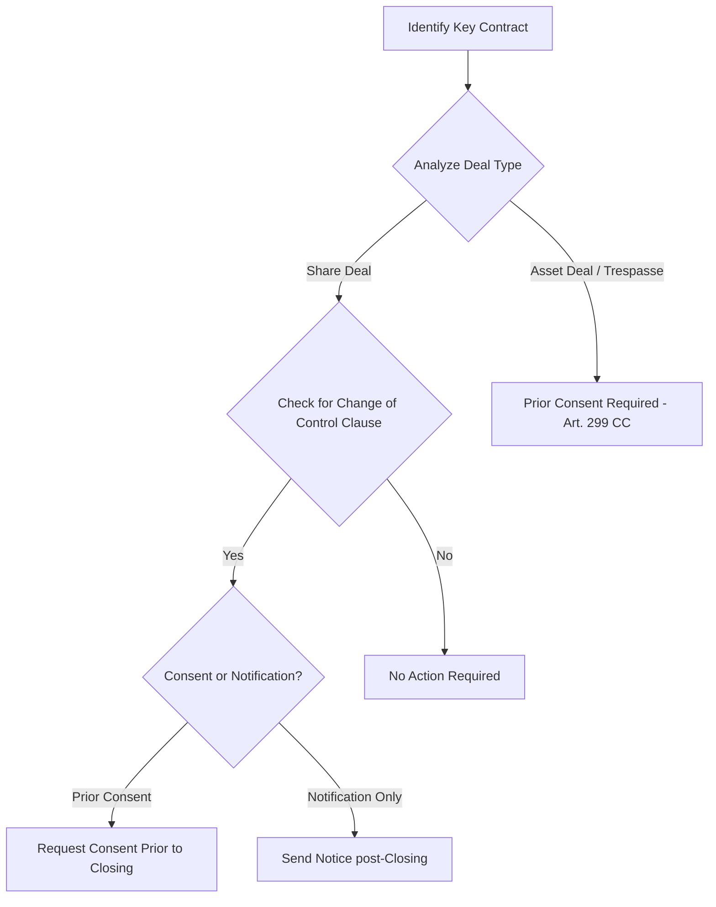

# Change of Control and Contractual Assignment in Brazilian M&A

Auditing the target company's commercial, financial, and administrative
agreements is essential to ensure operational continuity post-transaction. This
guide focuses on identifying Change of Control (CoC) and Contractual Assignment
(_Cessão de Posição Contratual_) restrictions.

---

## 1. Legal Distinctions: Share Deal vs. Asset Deal

### 1.1. Share Deal (Quota/Share Purchase)

- **Legal Mechanism:** The contracting party (the target company) remains
  unchanged. Only the equity ownership of the company is transferred to the
  buyer.
- **Applicability:** General assignment clauses do not apply because the company
  is not transferring the contract. However, **explicit Change of Control
  clauses** will be triggered if the contract defines a change in direct or
  indirect ownership as a trigger event.

### 1.2. Asset Deal (Transaction of Business Establishment - _Trespasse_)

- **Legal Mechanism:** The business assets, liabilities, and contracts are
  transferred from the seller to the buyer.
- **Consent Requirement (Art. 299, Civil Code):** The assignment of any contract
  or debt requires the **express or tacit consent** of the counterparty.
- **Commercial Leases (Art. 13, Law 8.245/91):** The assignment, sublease, or
  loan of a leased property requires the prior written consent of the landlord.
  Silence for 30 days after formal notification does not imply consent.

---

## 2. Key Contract Categories and Audit Playbook

During due diligence, the agent must categorize contracts by materiality (e.g.,
contracts representing > 5% of revenue or supply costs) and extract the
following clauses:

### 2.1. Commercial Leases (_Contratos de Locação Comercial_)

- _Risk:_ Landlords often use the change of control of the tenant as leverage to
  renegotiate rental prices or force the tenant out.
- _DD Checklist:_ Search for clauses stating that change in the control of the
  tenant entity is deemed an unauthorized assignment, triggering termination or
  a penalty.

### 2.2. Banking and Finance Agreements (_Contratos de Financiamento_)

- _Risk:_ Almost all credit agreements (private banks, debentures, BNDES)
  contain strict Change of Control clauses.
- _Consequence:_ Changing control without prior bank consent triggers **early
  maturity of the debt** (_vencimento antecipado_).
- _DD Checklist:_ Check for financial covenants, debt-to-equity ratios, and
  cross-default provisions that could be triggered globally by the transaction.

### 2.3. Key Supplier Agreements (_Fornecedores Estratégicos_)

- _Risk:_ If the target relies on exclusive distributors or IP licensing, the
  supplier might have the right to terminate the agreement or revoke exclusivity
  if control changes (especially if the buyer is a competitor).
- _DD Checklist:_ Look for non-compete covenants and termination-for-convenience
  clauses with short notice periods (e.g., 30 days).

### 2.4. Public and Concession Contracts (_Contratos Administrativos_)

- _Legal Framework (Art. 122, Law 14.133/2021):_ In public procurement and
  concessions, the transfer of concession control or the merger/spin-off of the
  contractor requires the **prior approval of the Public Administration**.
- _Consequence:_ Failure to obtain approval can result in the unilateral
  termination of the public contract by the government entity (_caducidade_) and
  suspension from bidding.

---

## 3. Auditing Tracking Matrix

The due diligence report must include a structured contract mapping table:

| Counterparty     | Contract Type         | Materiality (Annual BRL) | Change of Control Clause? (Yes/No) | Notice Period / Consent Requirement      | Risk Rating (High/Med/Low) | Action Required                    |
| :--------------- | :-------------------- | :----------------------- | :--------------------------------- | :--------------------------------------- | :------------------------- | :--------------------------------- |
| _Bank Alpha_     | BNDES Financing       | BRL 12,000,000           | Yes                                | Prior written consent (45 days)          | **High**                   | Obtain waiver prior to signing.    |
| _Landlord Beta_  | Commercial Lease      | BRL 1,500,000            | Yes                                | Prior written consent (30 days)          | **Medium**                 | Negotiate lease amendment.         |
| _Supplier Gamma_ | Core Raw Material     | BRL 8,000,000            | No (Assignment only)               | None (for Share Deal)                    | **Low**                    | Send post-closing notice.          |
| _Client Delta_   | Master Services (MSA) | BRL 22,000,000           | Yes                                | Notification within 15 days post-closing | **Low**                    | Prepare post-closing notification. |
