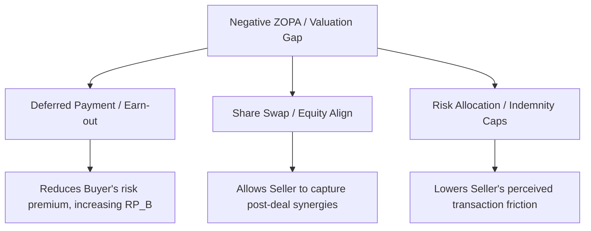

# BATNA and ZOPA Negotiation Framework for M&A

This document provides an analytical framework for identifying, calculating, and leveraging the Best Alternative to a Negotiated Agreement (BATNA) and the Zone of Possible Agreement (ZOPA) in corporate acquisitions.

---

## 1. Determining BATNA (Best Alternative to a Negotiated Agreement)

A negotiator's BATNA is the course of action they will pursue if the current negotiation fails. It is the baseline against which any proposed agreement must be measured.

### A. The Seller's BATNA Options
1.  **Status Quo / Stand-alone Growth:** Continued execution of the independent business plan, financed by operating cash flow or debt.
2.  **Alternative Bidders:** Actively soliciting bids from other strategic buyers or private equity funds.
3.  **Initial Public Offering (IPO):** Listing on the exchange (e.g., B3's Novo Mercado), subject to market window availability.
4.  **Joint Venture (JV) or Strategic Partnership:** Selling a minority stake while retaining operational control.

### B. The Buyer's BATNA Options
1.  **Organic Build (Build vs. Buy):** Developing the technology, market share, or product line internally.
2.  **Targeting Competitors:** Acquiring alternative targets in the same sector.
3.  **Capital Reallocation:** Returning capital to shareholders via dividends/buybacks or investing in higher-yield corporate projects.

---

## 2. Calculating the Reservation Price (Walk-away Price)

The Reservation Price ($RP$) is the quantitative boundary of the negotiation. It is the absolute maximum a buyer will pay or the absolute minimum a seller will accept.

### A. Seller's Reservation Price ($RP_S$)
The Seller's $RP$ must reflect the net present value of their BATNA, adjusted for tax impacts and transaction friction:
$$RP_S = NPV(BATNA_{Seller}) + Friction\ Costs_{Seller} - Tax\ Drag + Strategic\ Risk\ Premium$$
Where:
*   *Friction Costs:* Investment banking fees, legal advisors, audit costs, and time spent by management.
*   *Tax Drag:* Capital gains tax (*IRPJ/CSLL* or *IRPF* on capital gain) differences between the transaction and the alternative.
*   *Strategic Risk Premium:* The quantified cost of market competition and execution risk of the stand-alone path.

### B. Buyer's Reservation Price ($RP_B$)
The Buyer's $RP$ is the maximum price at which the transaction remains value-accretive:
$$RP_B = NPV(Target\ Stand-alone) + NPV(Captured\ Synergies) - Integration\ Costs - Risk\ Premium$$
Where:
*   *NPV(Captured Synergies):* The present value of cost and revenue synergies, adjusted for probability of capture.
*   *Integration Costs:* IT migrations, rebranding, employee severance, and organizational restructuring.
*   *Risk Premium:* Adjustment for execution and cultural fit risks.

---

## 3. Identifying the ZOPA (Zone of Possible Agreement)

The ZOPA is the range between the two reservation prices where a deal is mutually beneficial.

### A. Positive ZOPA
A transaction can only close voluntarily if the Buyer's maximum willingness to pay ($RP_B$) is greater than or equal to the Seller's minimum acceptable price ($RP_S$):
$$ZOPA = [RP_S, \ RP_B] \quad \text{where} \quad RP_S \le RP_B$$

```
   Seller's Reservation Price (RP_S)      Buyer's Reservation Price (RP_B)
--------------[===================================]------------------------> Price
                     ZONE OF POSSIBLE AGREEMENT (ZOPA)
```
*   **Negotiation Surplus ($S$):** The total value created by reaching an agreement:
    $$S = RP_B - RP_S$$
*   **Distribution:** The final price $P^*$ will lie inside the ZOPA. The division of the surplus depends on relative bargaining power:
    $$P^* = RP_S + \alpha \cdot S \quad \text{where} \quad \alpha \in [0, 1]$$

### B. Negative ZOPA (Valuation Gap)
When $RP_B < RP_S$, there is no overlapping pricing zone. A direct transaction at a flat cash price is mathematically impossible.

```
   Buyer's Reservation Price (RP_B)      Seller's Reservation Price (RP_S)
--------------]                                   [------------------------> Price
                                NO ZOPA
```

### C. Bridging a Negative ZOPA
To transform a negative ZOPA into a positive negotiation space, structure adjustments must be introduced:



1.  **Earn-outs:** Shifting risk back to the Seller increases the Buyer's $RP_B$ by reducing the risk premium adjustment.
2.  **Seller Notes (Vendor Loans):** The Seller finances part of the acquisition, allowing the Buyer to defer capital outlay, lowering the discount factor penalty on the Buyer's valuation.
3.  **Equity Share Swaps:** Aligning interests so that both parties share in the upside of captured synergies, modifying the valuation basis from target-only to combined-entity.
