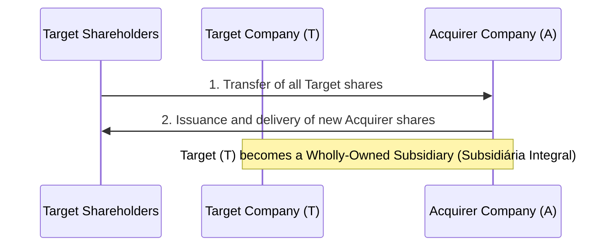

# Transaction Structuring Templates and Guidelines in Brazil

This document outlines the standard methodologies, legal foundations, and templates for structuring corporate acquisitions in Brazil.

---

## 1. Cash-Free Debt-Free (CFDF) Pricing Model

The CFDF mechanism ensures that the Buyer pays the Enterprise Value ($EV$) of the target business operations, adjusted for cash and debt at the closing date.

### A. The Equity Value Formula
$$Equity\ Value\ (Purchase\ Price) = EV + Cash_{closing} - Debt_{closing} \pm (NWC_{closing} - NWC_{target})$$

### B. Defining Elements under Brazilian Accounting (CPC/IFRS)
*   **Cash (*Caixa e Equivalentes de Caixa*):**
    *   Cash on hand and demand deposits.
    *   Highly liquid financial investments (e.g., CDIs) redeemable within 90 days without penalty.
*   **Debt (*Endividamento Financeiro e Assemelhados*):**
    *   Loans and financing with financial institutions (*empréstimos e financiamentos*).
    *   Debentures and other debt securities.
    *   Tax parceling programs (e.g., *REFIS, PRT, Transações Tributárias*), including principal, interest, and penalties.
    *   Lease liabilities under **CPC 06 (R2) / IFRS 16** (capitalized operating leases).
    *   Unpaid dividends declared prior to closing.
    *   Labor, civil, and tax contingencies classified by due diligence auditors as having a **"probable"** risk of loss (CPC 25 provisions).
*   **Net Working Capital (NWC - *Capital de Giro Líquido*):**
    *   Formula:
        $$NWC = (Accounts\ Receivable + Inventory + Prepaid\ Expenses) - (Accounts\ Payable + Salaries\ Payable + Taxes\ Payable)$$
    *   *NWC Adjustment:* Calculated relative to a historical 12-month average baseline (*Capital de Giro Meta*). If the actual closing NWC is lower than the target, the Purchase Price is adjusted downward dollar-for-dollar.

---

## 2. Share Swaps (*Incorporação de Ações* - Art. 252, Lei das S.A.)

Under Art. 252 of the Brazilian Corporations Law (Lei nº 6.404/1976), an *incorporação de ações* is a corporate reorganization where all shares of a target company ($T$) are transferred to the acquirer ($A$) in exchange for new shares issued by $A$. $T$ becomes a wholly-owned subsidiary (*subsidiária integral*) of $A$.

### A. Transaction Flow

### B. Procedural Steps and Legal Requirements
1.  **Protocolo e Justificação (Art. 224 & 225):** The management of both companies drafts the protocol and justification detailing the transaction terms, exchange ratio (*relação de substituição*), and financial impact.
2.  **Laudo de Avaliação (Art. 8 & Art. 252, § 1º):** An independent appraisal firm (*empresa avaliadora*) must value the target's shares at market value or net equity value to justify the capital increase of the Acquirer.
3.  **Deliberação Societária (Art. 252, § 2º):** The transaction must be approved at Extraordinary General Meetings (AGE) of both the Target and the Acquirer.
4.  **Direito de Recesso (Art. 137 & Art. 252, § 1º):** Dissenting shareholders of both the Target and the Acquirer may have the right to withdraw from the company and demand the redemption of their shares, valued based on the company's net book equity (*valor patrimonial*), unless the shares are liquid and dispersed in the market.

---

## 3. Asset Purchase (*Trespasse*) vs. Equity Purchase

The choice of deal structure drastically alters the legal risk profile and tax consequences in Brazil.

| Structuring Criteria | Equity Purchase (Quota/Share Sale) | Asset Purchase (*Trespasse* - Art. 1.142 CC) |
| :--- | :--- | :--- |
| **Target Entity** | Purchase of shares/quotas of the existing Legal Entity (*Pessoa Jurídica*). | Purchase of the organized assets/establishment (*Estabelecimento Empresarial*). |
| **Consent Requirements** | Board or shareholder approval. | Creditor notification and consent required if remaining assets are insufficient (Art. 1.144 CC). |
| **Pre-closing Liabilities** | Remains within the target entity; buyer relies on SPA indemnity and escrow protection. | Joint and several liability (*responsabilidade solidária*) of the seller for 1 year from publication (Art. 1.146 CC). |
| **Tax Succession** | Absolute succession. The target company retains all tax liabilities. | Successor liability applies under **Art. 133 of the CTN** if the buyer continues the same business activity. |
| **Labor Succession** | Unchanged. The employer entity remains the same. | Successor liability applies under **Art. 10 and 448 of the CLT** for all transferred employees. |
| **Contract Transfer** | Automatic (unless change of control clauses exist). | Individual assignment of each commercial contract/license is required. |

---

## 4. Deferred Payment Mechanisms

To balance cash flows and hedge against post-closing contingency risks, Brazilian transactions utilize:

1.  **Preço Retido (Retainage):** A unilateral deduction from the purchase price held by the Buyer for a defined period (e.g., 10% for 3 years) to offset indemnification claims directly via set-off (*compensação*), without third-party escrow.
2.  **Notas Promissórias (Promissory Notes):** Issuance of debt instruments by the Buyer to the Seller. These notes must contain clear subordination clauses and be linked to the SPA's offset terms to allow the Buyer to deduct unpaid indemnity claims from the note payments.
3.  **Parcelas Diferidas com Correção:** Deferred payments indexed to inflation (typically *IPCA* or *IGP-M*) plus a negotiated interest rate (e.g., 4% to 6% p.a. or a percentage of CDI).
