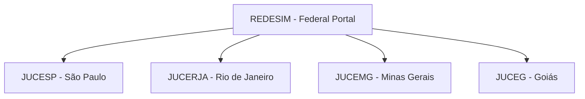

# Guide to Brazilian Public Databases for Due Diligence & KYB

## 1. Introduction
This guide outlines the official public databases, portals, and application programming interfaces (APIs) required to execute background checks, Know Your Business (KYB) verifications, and compliance due diligence on corporate entities and individuals in Brazil.

---

## 2. Receita Federal do Brasil (RFB)
The RFB is the primary authority for tax and corporate registration.

### 2.1 CNPJ Status Verification
* **Database Name:** *Cadastro Nacional da Pessoa Jurídica* (CNPJ).
* **Access URL:** [Receita Federal CNPJ Portal](https://servicos.receita.fazenda.gov.br/servicos/cnpjreva/cnpjreva_solicitacao.asp)
* **Key Fields & Legal Meaning:**
  * **Situação Cadastral:**
    * `ATIVA` (Active): Normal operational status.
    * `INAPTA` (Inapt): Suspended due to failure to submit tax returns for two consecutive years. Inapt companies cannot issue invoices (*notas fiscais*), and their bank accounts are frozen.
    * `SUSPENSA` (Suspended): Under investigation for fraud, inconsistencies, or judicial orders.
    * `BAIXADA` (Extinct): Extinguished by request of the partners or by official mandate.
  * **Quadro de Sócios e Administradores (QSA):** Identifies the partners, their respective capital share (for Ltda entities), and the registered administrators. Look for roles such as:
    * `05-Administrador` (Administrator)
    * `10-Sócio-Gerente` (Managing Partner)
    * `22-Sócio-Administrador` (Partner-Administrator)

### 2.2 Federal Tax Certifications (CND)
* **Database Name:** *Certidão de Débitos Relativos a Créditos Tributários Federais e à Dívida Ativa da União*.
* **Access URL:** [Certidão Federal RFB Portal](https://solucoes.receita.fazenda.gov.br/Servicos/certidaointernet/PJ/Consultar)
* **Output Types:**
  * `Certidão Negativa (CND)`: No outstanding federal tax debts.
  * `Certidão Positiva com Efeitos de Negativa (CPEN)`: Debts exist but are suspended (e.g., under court dispute with judicial deposit or enrolled in an active installment plan - *parcelamento*).
  * `Certidão Positiva (CPD)`: Active tax debts; high risk of asset seizure.

---

## 3. Redesim & Juntas Comerciais (State Commercial Boards)
While the RFB holds federal tax data, the corporate actions (constitution, mergers, bylaws) are registered at the state level.



### 3.1 Document Types to Request
1. **Ficha Cadastral Simplificada (Simplified Ledger):** Summarizes current partners, corporate address, capital, and active administrators.
2. **Ficha Cadastral Completa (Historical Ledger):** Lists all corporate updates since foundation (capital increases, partner exits, address changes). Essential for tracing previous transaction history.
3. **Contrato Social / Estatuto Social (Bylaws):** The original constitution document.
4. **Alterações Contratuais (Bylaw Amendments):** Sequentially numbered updates. Always request the *Última Alteração Contratual Consolidada* (Last Consolidated Amendment).

### 3.2 Tracking Board Changes and Capital Increases
* **Board Changes:** Check the dates of administrator appointments. A sudden change of management right before an M&A transaction or during a financial crisis is a severe red flag.
* **Capital Increases (*Aumento de Capital Social*):** Check if capital increases were paid in cash (*integralizado em moeda corrente*) or through assets (e.g., real estate, machinery). If through assets, request the independent valuation report (*laudo de avaliação*) to verify asset inflation.

---

## 4. Labor Courts & Liabilities (TST & BNDT)
Labor liabilities in Brazil can easily surpass civil debts due to strict pro-employee jurisprudence.

### 4.1 CNDT (Certidão Negativa de Débitos Trabalhistas)
* **Database Name:** *Banco Nacional de Devedores Trabalhistas* (BNDT), managed by the *Tribunal Superior do Trabalho* (TST).
* **Access URL:** [TST CNDT Portal](https://www.tst.jus.br/certidao)
* **Significance:** A Positive Labor Certificate indicates that the target has failed to pay an established labor judgment, meaning judicial blockages of bank accounts (*Bacenjud*) are imminent.

### 4.2 Regional Labor Courts (TRTs)
* Brazil is divided into 24 Labor Regions (TRTs).
* A query must be performed in the regional TRT of the target’s operations (e.g., TRT-2 for São Paulo, TRT-1 for Rio de Janeiro) to identify ongoing, non-adjudicated labor claims, which do not appear in the BNDT until final execution.

---

## 5. Public Integrity & Sanction Lists (CGU / Portal da Transparência)
The *Controladoria-Geral da União* (CGU) maintains lists of individuals and entities sanctioned for administrative misconduct, fraud, and corruption.

* **CEIS (Cadastro de Empresas Inidôneas e Suspensas):** Companies banned from participating in public bids or contracting with any level of government (federal, state, municipal).
* **CNEP (Cadastro Nacional de Empresas Punidas):** Lists companies sanctioned under the Brazilian Anti-Corruption Law (Law 12.846/2013). Displays fine amounts, leniency agreement violations, and administrative sanctions.
* **CEPIM (Cadastro de Entidades Privadas Sem Fins Lucrativos Impedidas):** Non-profit organizations barred from receiving public transfers or partnerships.
* **CEAF (Cadastro de Expulsões da Administração Federal):** Expelled federal civil servants, useful for mapping background risks of prospective directors.

---

## 6. SERPRO API Platform
SERPRO (Serviço Federal de Processamento de Dados) is the state-owned IT company that commercializes direct, real-time access to Receita Federal databases.

### 6.1 Authentication and Connection Flow
Queries to SERPRO APIs require a paid contract and authentication via **OAuth 2.0 (Client Credentials Flow)**.

1. **Step 1: Request Access Token**
   * Endpoint: `POST https://gateway.apiserpro.serpro.gov.br/token`
   * Headers: `Authorization: Basic [Base64(ConsumerKey:ConsumerSecret)]`
   * Body: `grant_type=client_credentials`
2. **Step 2: Query API**
   * Endpoint: `GET https://gateway.apiserpro.serpro.gov.br/consulta-cnpj-v2/v2/empresa/{cnpj}`
   * Headers: `Authorization: Bearer [AccessToken]`

### 6.2 Target JSON Response Structure (CNPJ API - High Level)
```json
{
  "cnpj": "00000000000191",
  "razao_social": "EMPRESA EXEMPLO S.A.",
  "nome_fantasia": "EXEMPLO M&A",
  "data_abertura": "2010-05-15",
  "situacao_cadastral": {
    "codigo": "2",
    "descricao": "ATIVA",
    "data": "2010-05-15"
  },
  "cnae_principal": {
    "codigo": "6201501",
    "descricao": "Desenvolvimento de programas de computador sob encomenda"
  },
  "capital_social": 5000000.00,
  "qsa": [
    {
      "nome": "SILVA, JOAO",
      "qualificacao": "Sócio-Administrador",
      "data_entrada": "2010-05-15"
    },
    {
      "nome": "HOLDING PARTICIPACOES LTDA",
      "qualificacao": "Sócio",
      "data_entrada": "2015-08-20"
    }
  ]
}
```

---

## 7. Technical Integration Code Sample
The following TypeScript (Deno/Node compatible) code demonstrates how to authenticate and query the **Portal da Transparência API** (maintained by CGU) to fetch CEIS sanctions.

```typescript
// query_ceis_sanctions.ts
import { delay } from "https://deno.land/std@0.177.0/async/delay.ts";

interface CeisSanction {
  id: number;
  cadastro: string;
  dataOrigemSancao: string;
  dataPublicacao: string;
  dataFimSancao?: string;
  pessoa: {
    nome: string;
    numeroInscricaoSocial: string;
    tipoPessoa: string;
  };
  orgaoSancionador: {
    nome: string;
    sigla: string;
  };
}

export class PortalTransparenciaClient {
  private baseUrl = "https://api.portaldatransparência.gov.br/api-de-dados";
  private apiKey: string;

  constructor(apiKey: string) {
    if (!apiKey) {
      throw new Error("Portal da Transparência API Key is required.");
    }
    this.apiKey = apiKey;
  }

  /**
   * Queries CEIS for sanctions based on a CNPJ.
   * @param cnpj 14-digit CNPJ string (numbers only)
   */
  async checkCEIS(cnpj: string): Promise<CeisSanction[]> {
    const cleanCnpj = cnpj.replace(/\D/g, "");
    if (cleanCnpj.length !== 14) {
      throw new Error("Invalid CNPJ format. Must be 14 digits.");
    }

    const url = `${this.baseUrl}/ceis?codigoSancionado=${cleanCnpj}&pagina=1`;

    try {
      const response = await fetch(url, {
        method: "GET",
        headers: {
          "Accept": "application/json",
          "chave-api-dados": this.apiKey,
        },
      });

      if (response.status === 429) {
        console.warn("Rate limit hit. Retrying after delay...");
        await delay(2000);
        return this.checkCEIS(cnpj);
      }

      if (!response.ok) {
        throw new Error(`API Error: ${response.statusText} (${response.status})`);
      }

      const data: CeisSanction[] = await response.json();
      return data;
    } catch (error) {
      console.error(`Failed to query CEIS for CNPJ ${cnpj}:`, error);
      throw error;
    }
  }
}
```
